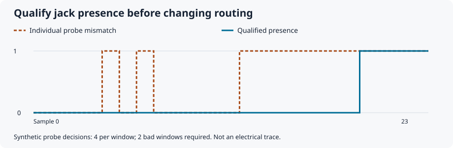
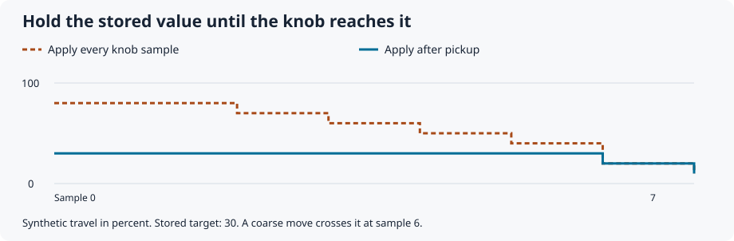
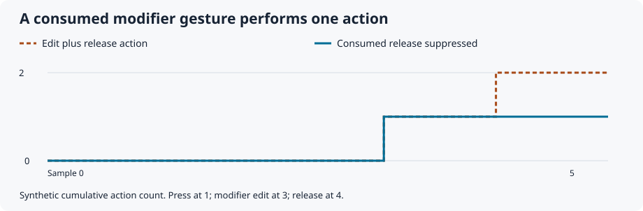

# Eurorack patterns

[](https://github.com/lylepmills/eurorack-patterns/actions/workflows/ci.yml)

Small, reusable building blocks for predictable Eurorack controls and firmware, with an attributed catalog of design ideas from existing instruments.

**[Read the 88-pattern catalog](docs/catalog.md)** · **[Source and bug-history research](docs/research-pass-2.md)** · **[See implementation coverage](docs/coverage.md)** · **[Attribution](ATTRIBUTION.md)** · **[Contribute](CONTRIBUTING.md)**

A cable should not change routing repeatedly while being inserted. A slow knob movement should eventually register. A modifier gesture should not also fire an unrelated release action. This project collects those details and provides portable implementations where the behavior can be specified and tested independently of a particular module.

## Start here

- **Explore design ideas:** browse the [88-pattern catalog](docs/catalog.md) by problem, then check its source and limits. A catalog entry is not necessarily an implemented component.
- **Use the C++ library:** follow the [shared-knob walkthrough](docs/quickstart.md), then build the optional [Raspberry Pi Pico adapter](examples/pico/README.md).
- **Contribute evidence:** report a [bug, source correction or measured trace](https://github.com/lylepmills/eurorack-patterns/issues/new/choose), or pick a [bounded contribution task](https://github.com/lylepmills/eurorack-patterns/issues?q=is%3Aissue%20is%3Aopen%20label%3A%22help%20wanted%22).

## Three small improvements

These illustrations are generated from executable-checked **synthetic** sequences, not hardware recordings. Counts, thresholds and delays are illustrative.







See the [trace program](examples/behavior_traces.cpp) and [validation limits](docs/validation.md).

## Included components

| Header | Reusable behavior | Contract and examples |
| --- | --- | --- |
| `presence.h` | Evidence windows, asymmetric presence qualification, explicit startup and invalid-data handling | [Inputs](docs/inputs.md) |
| `events.h` | Schmitt rising edges, bounded pending event counts, explicit acquisition and overflow policies | [Inputs](docs/inputs.md) |
| `controls.h` | Crossing pickup in a caller-mapped domain, endpoint-aware motion acceptance, neutral zones, discrete hysteresis | [Controls](docs/controls.md) |
| `gestures.h` | Press-time role ownership; consuming a gesture suppresses its release action | [Controls](docs/controls.md) |
| `timing.h` | Mechanical button qualification with separate press and release durations | [Timing](docs/timing-and-transitions.md) |
| `pickup.h` | Stateful pickup in caller-mapped bounds, unreachable-target status, explicit rearm and invalid-gap handling | [Pickup](docs/pickup.md) |
| `pulses.h` | Logical pulse expiry, restart/ignore retrigger policies, immediate cancellation | [Pulses](docs/pulses.md) |
| `trigger_delay.h` | Bounded per-input trigger identity across caller-owned ticks | [Trigger delay](docs/trigger-delay.md) |
| `transitions.h` | Retain the latest requested destination until an explicit commit boundary | [Transitions](docs/timing-and-transitions.md) |

The library is header-only C++11, with no third-party runtime dependency, heap allocation, exceptions, or hardware SDK. Components use per-instance or caller-owned state. They require one owner or external synchronization; they do not make an interrupt/foreground handoff thread-safe.

Compile input validation with ordinary finite/NaN semantics; `-ffast-math` and equivalent finite-only assumptions are unsupported.

Board adapters supply samples, validity, scaling, and time. The application decides routing, musical boundaries, display feedback, and recovery policy. Filtering durations and electrical thresholds must be chosen for the actual circuit. Host tests include synthetic traces; this release does not claim validation on a production module.

## Use it

Copy `include/eurorack_patterns/` plus `LICENSE` and `ATTRIBUTION.md` into your project and add the parent include directory. Each header works independently. See the [control-loop example](examples/control_loop.cpp) and [event-path example](examples/event_paths.cpp), including retry after queue rejection.

For a shared continuous knob, start with the stateful `PickupLatch`:

```cpp
#include <eurorack_patterns/pickup.h>

eurorack_patterns::PickupLatch pickup;
// Initialization (check Configure/Arm results when using runtime values):
pickup.Configure(0.0f, 1.0f, 0.005f);
pickup.Arm(0.3f); // stored value changed; re-arm on each external edit

// In your single-owner acquisition loop:
if (pickup.Observe(mapped_knob_sample, sample_valid)) {
  set_parameter(mapped_knob_sample);
}
```

The [complete example](examples/pickup_workflow.cpp) adds initialization, validity before motion filtering, ownership changes and reset. `Observe` returns permission to apply a sample, not a changed-value event. The [walkthrough](docs/quickstart.md) explains the ordering and policies.

Use `controls.h`'s lower-level predicates and percent convenience functions when your application already manages pickup state/history. They remain supported; they do not automatically break crossing history across invalid gaps. Numeric tolerances are configurable demonstration values.

CMake projects can use a pinned dependency:

```cmake
include(FetchContent)
FetchContent_Declare(eurorack_patterns
  GIT_REPOSITORY https://github.com/lylepmills/eurorack-patterns.git
  GIT_TAG d11583371156d54e569d574ee86eaa24375272ec) # v0.2.0
FetchContent_MakeAvailable(eurorack_patterns)
target_link_libraries(your_firmware PRIVATE eurorack_patterns::eurorack_patterns)
```

This full commit pin selects the published v0.2.0 core, which the new examples also support. Each [release](https://github.com/lylepmills/eurorack-patterns/releases/latest) supplies its own full commit pin; use the tested version you intend to ship. Tests default off when included as a subproject. An installed package also supports `find_package(eurorack_patterns CONFIG REQUIRED)`.

## Build and test

```sh
cmake -S . -B build -DCMAKE_BUILD_TYPE=Release
cmake --build build --config Release
ctest --test-dir build -C Release --output-on-failure
```

Tests remain active with `NDEBUG`. They cover invalid and duplicate evidence, insertion chatter, noisy slow movement, exact endpoints, pickup reversal, gesture consumption, event overflow, timer wrap, rapid destination changes, unreachable pickup, pulse retrigger/cancellation, and delayed input identity. Deterministic reference models and bounded trace enumeration supplement the example traces. The fixtures identify themselves as synthetic. To enable address and undefined-behavior sanitizers on GCC or Clang, configure with `-DEURORACK_PATTERNS_SANITIZERS=ON`.

The [coverage map](docs/coverage.md) separates implemented mechanisms from application recipes and hardware measurements. The [validation guide](docs/validation.md) records the synthetic checks and the measurements still needed. Clock tracking, audio fades, storage backends, and electrical protection remain documented patterns, with their conditions and proposed checks. They are not silently treated as solved by this library.

## License and provenance

MIT, copyright 2026 Lyle Mills. Commercial use and modification are welcome; preserve the required notices. The catalog credits makers beside each observation, and [ATTRIBUTION.md](ATTRIBUTION.md) records source revisions and the distinction between inspiration, adaptation, and copied code. Linked manuals and projects retain their own licenses.

Version 0.2.1 preserves the 0.2.0 library interfaces and behavior; the API is still pre-1.0. Pin a release and run your product's integration tests when updating. Changes to behavior or public interfaces will be described in the changelog.

Maintainers follow the [release checklist](docs/releasing.md), including public-content review and immutable releases.
