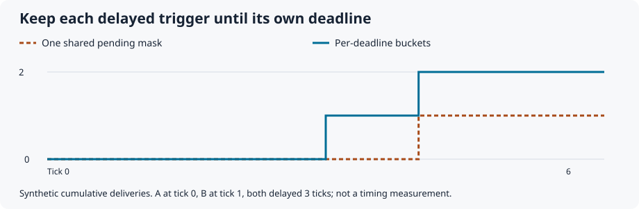
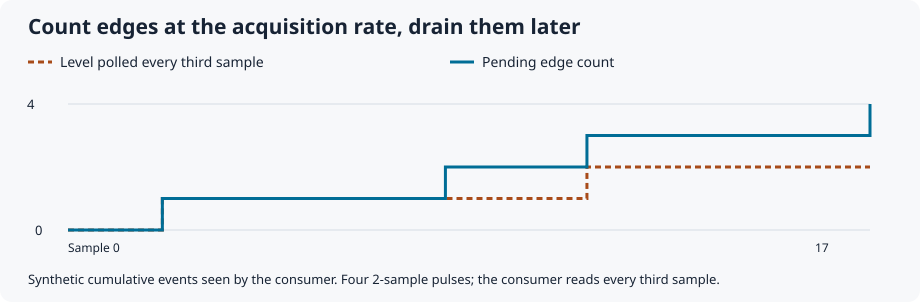
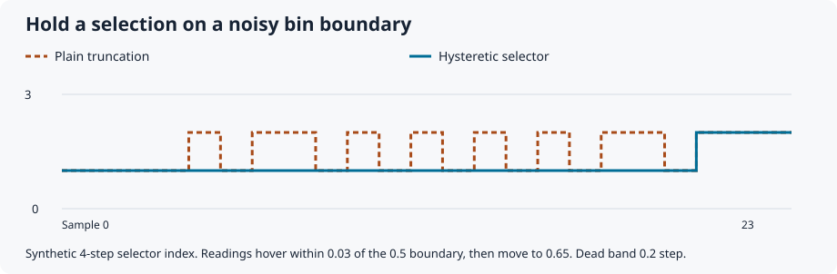
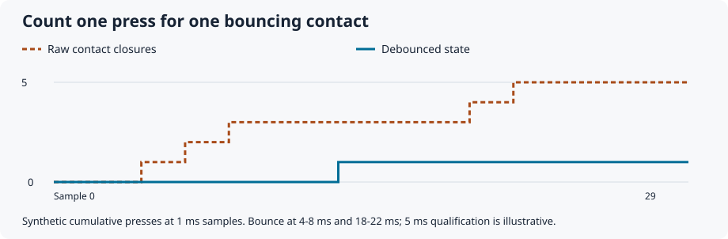
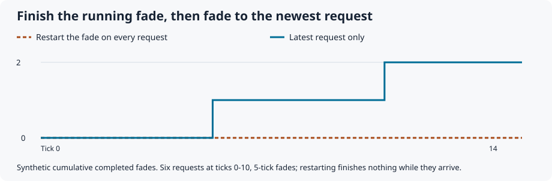

<!-- SPDX-License-Identifier: MIT -->
<!-- Copyright 2026 Lyle Mills -->
# Bug pictures

Every picture here is generated from an executable-checked **synthetic**
sequence in the [trace program](../examples/behavior_traces.cpp), rendered by
[`tools/render_traces.py`](../tools/render_traces.py). None is a hardware
recording. Counts, thresholds, delays and durations are illustrative values
chosen to make each mechanism visible, not recommended tuning constants; the
[validation guide](validation.md) states what synthetic host checks can and
cannot establish. The orange dashed line is a naive implementation; the blue
line is the component.

The trace program is a CMake test, so every plotted value is asserted on each
run. To regenerate the pictures after changing a trace or the renderer:

```sh
cmake --build build --config Release
python3 tools/render_traces.py build/example_behavior_traces
python3 tools/render_traces.py build/example_behavior_traces --check
```

CI runs the `--check` form and fails on a stale picture. The README shows the
first six; the last two live only here.

## Presence

**Routing flips while a cable is still going in.** [`presence.h`](inputs.md#presence-evidence)
qualifies presence over complete evidence windows, so individual probe
mismatches do not change routing.


## Pickup

**A recalled value jumps as soon as the knob moves.** [`pickup.h`](pickup.md)
holds the stored value until the knob crosses it.


## Gesture

**A modifier edit also fires the button's release action.** [`gestures.h`](controls.md)
gives each press one role; consuming the gesture suppresses its release.


## Trigger delay

**A later trigger overwrites an earlier one that is still waiting.** With one
shared pending mask and deadline, B's request replaces A's before A's delay
matures, so only B is delivered. [`trigger_delay.h`](trigger-delay.md) keeps
one bucket per deadline, so A arrives at tick 3 and B at tick 4.



## Edge events

**A slow consumer polls the level and misses short pulses.** Four two-sample
pulses arrive while the consumer reads every third sample; comparing the level
at consume time sees two of them. [`events.h`](inputs.md#rising-edge-capture)
counts rising edges at the acquisition rate and holds them in a bounded pending
count until the consumer drains it, so all four are delivered. A pulse that
falls entirely between two acquisitions is still invisible; see the contract.



## Hysteretic selection

**A noisy reading on a bin boundary flickers between two choices.** A four-step
selector reads values hovering within 0.03 of the boundary between steps 1 and
2. Plain truncation changes its answer fifteen times in twenty samples.
[`SelectHysteretic`](controls.md) in `controls.h` adds a dead band of 0.2 step
around each boundary, holds step 1 through the noise, and still follows the
deliberate move to 0.65 at the end.



## Debounce

**One press of a bouncing contact counts as several.** Sampled every
millisecond, the contact chatters for a few milliseconds on press and again on
release. Counting raw closures gives five presses.
[`DebouncedButton`](timing-and-transitions.md) in `timing.h` publishes a
state only after it has held for the configured duration, so the same
sequence counts one press. The 5 ms duration is illustrative; a real contact
needs its own measurement.



## Latest request

**Restarting a fade on every request never finishes it.** Six preset requests
arrive two ticks apart while each fade takes five ticks. Restarting the fade on
each request completes nothing for as long as requests keep arriving.
[`LatestRequest`](timing-and-transitions.md) in `transitions.h` keeps only the
newest request: the running fade completes, the application takes the latest
destination at that boundary, and the intermediate presets are never started.


