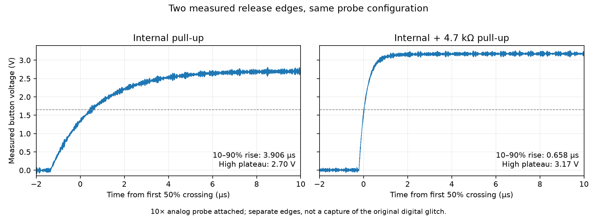

# Evidence and validation

Source confidence and product qualification are different. A verified fix can motivate a good contract; a host test can establish that our implementation follows it; neither proves that a chosen threshold, scan cadence or electrical interface works on a particular module.

## Executed host checks

The suite combines synthetic adversarial fixtures with the explicitly labeled [Daisy measurements below](#first-daisy-measurements). The published 0.2.1 release predates those measurements. The CMake tests use always-active checks in release builds, compile as C++11 with warnings as errors and no exceptions/RTTI, compile every public header independently, and exercise an installed-package consumer. The existing CI matrix covers Linux, macOS and Windows; Linux enables address and undefined-behavior sanitizers. The second pass also ran the local suite with those sanitizers on Apple Clang.

| Mechanism | Evidence executed in this repository | What the check cannot establish |
| --- | --- | --- |
| Presence qualification | Startup/chatter/gap traces; all 6,561 eight-symbol traces over match/mismatch/invalid for 30 small window/threshold/streak configurations. Invalid-gap restart equivalence and published-state preservation. | Probe generation, correlated audio rejection, jack contacts, actual insertion latency. |
| Edge capture | Threshold/acquisition/overflow traces; deterministic independent three-level reference plus event-count conservation under bounded queues and invalid samples. | Pulses missed by acquisition, electrical thresholds, concurrent access safety. |
| Existing control helpers | Endpoint, slow-motion and pickup checks; transfer-map order/range/symmetry and selector sweeps. | ADC noise, comfortable neutral widths, musician preference. |
| Mechanical debounce | Bounce/invalid traces; unwrapped 64-bit reference time versus modular timestamps; directed maximum-duration and wrap/gap boundaries. | Unobserved contact bounce or an appropriate physical debounce time. |
| `PickupLatch` | Unreachable/reversed/constant ranges, strict tolerance, skipped targets, rearm, invalid-gap history break, rejected configuration and bidirectional sweeps. | Discrete/nonmonotone reachability, external target changes the caller fails to report. |
| `PulseTimer` | Exact expiry, maximum width/wrap, ignored/restarted requests, zero disable, cancel/rearm and stale deadline; two 20,000-step absolute-deadline reference traces. An unserviced expiry/retrigger explicitly produces no observed low edge. | Physical width, edge jitter, separate retrigger delivery, polarity, hardware timer dispatch. |
| `TriggerDelay` | A/B identity regression, overlapping deadlines, zero/maximum/invalid delay, high bit, reset, coalescence, ring wrap; 2,000 ticks compared to an absolute-deadline map; C++11 public-constant linkage. | Sub-tick multiplicity, fixed real-time cadence, CV settling, electrical inputs. |
| Integration compositions | Runnable control and event-path examples, including delayed per-output pulses, pickup reachability and retaining feedback after queue rejection. | A complete firmware adapter or timing on a real interrupt/foreground boundary. |

Independent review corrected test blind spots before release: the event reference initially reused the class under test, and random timing inputs never exercised acceptance at the maximum duration. Review also found and fixed a C++11 link failure when taking the address of the trigger delay's public constants. These are host-level findings, not upstream module bugs.

## How to promote a pattern

1. **Pin the observation.** Record product, source revision or manual version, exact behavior and whether it is a merged fix, branch proposal, user report or measured result. Read the patch and its callers; avoid inferring a current defect from an old issue title.
2. **Specify the boundary.** State units, ownership, initialization, invalid-data behavior, bounds/overflow, cancellation and ordering. Include a counterexample to an overly broad version of the advice.
3. **Build a small adversarial replay.** Include the reported failure shape, exact boundaries, reset/rearm, gaps, nonfinite inputs where applicable and time wrap. Use an independent representation for an oracle where practical. A test that copies the implementation formula has limited independence.
4. **Measure the adapter.** Establish sample freshness, scan/service cadence, clock domain crossings and worst-case load on the intended board. Instrumentation must not introduce the fault it measures; buffer traces and drain them outside timing-critical work.
5. **Validate product behavior.** Use receiving modules, real patching and musicians. Record false actions, lost events, latency distribution, recovery and control feel against stated acceptance criteria. A second unrelated hardware adapter tests portability better than another wrapper around the same board SDK.

## Next measurements, in useful order

| Experiment | Capture | Acceptance question |
| --- | --- | --- |
| Jack insertion and removal | Raw probe/sample, freshness/sequence, expected probe, qualified state, independent physical/electrical ground truth | Does tentative insertion cause unwanted routing changes? How long do genuine changes take? Repeat silent sources, slow insertion, worn sockets and separately powered cases. |
| Output pulse under load | Requested event time, logical deadline, actual pin high/low edges; stress display, storage and communications | Are minimum high/low widths and worst-case jitter acceptable to the receiver? Can late service join pulses? |
| CV-before-gate acquisition | Independent CV step and gate timing, ADC sample timing, captured value and emitted trigger | What delay preserves intended pitch without losing fast notes? Sweep positive and negative skew. |
| Shared-control takeover | Raw/mapped knob, target, validity, owner/bank changes and resulting value | Is pickup reliable across noise, slow/coarse movement, endpoints, invalid gaps and external edits? Do unreachable indications help the player recover? |
| Saves and teardown | Interrupt/worker timelines, command acceptance, saved bytes, load result, resource lifetime | Are writes coherent and readers quiescent? A separate controlled power-cut campaign is required for atomicity claims. |

Do not set universal numeric thresholds from these host fixtures. Hardware tests should specify an acceptance budget before tuning and keep failing traces as regression inputs afterward.

## Trace provenance

When contributing a measured trace, include device/board revision, firmware commit, acquisition date and method, raw units/scaling, sample period or timestamps, calibration, dropped/duplicate-sample indicators, workload and trigger/ground-truth method. Record the expected result and why it is independent of the algorithm under test. Label generated stimuli separately from recorded samples. Remove device serial numbers, personal data and private patches.

Keep both the original acquisition and a minimal replay, with a documented transformation between them. A replay can validate the pure component while a scope/logic-analyzer capture validates the adapter. Neither should silently stand in for the other.

## Integration preparation in 0.2.1

The release adds a host-tested shared-knob adapter, a complete takeover/reset
walkthrough and three synthetic illustrations generated from checked executable
traces. CI checks illustration freshness. The public core headers are unchanged.
The host suite has 24 checks, plus installed-package consumers. A separate ARM
build instantiates all nine headers and compiles each independently for Cortex-M0+.
The optional Pico SDK example links a firmware ELF using the same adapter.
These cross-builds establish compiler/SDK compatibility only: the Pico has not
been flashed or measured as part of this release. See its [remaining bench
checks](../examples/pico/README.md#adapter-decisions-and-checks-still-needed).

## Daisy Seed3 jack-presence bench

The separate `jack-bench` firmware and `jack_capture.py` exercise the existing
`PresenceDetector` through a real switched jack. The
[empty-jack preflights](../tests/measured/daisy/2026-10-19-jack-empty) and
[stationary open-ended cable](../tests/measured/daisy/2026-10-19-jack-inserted-open)
are measured, along with a
[passive far-end termination](../tests/measured/daisy/2026-10-19-jack-inserted-silent).
Ordinary and slow insertion/withdrawal have also passed complete physical review,
including ordinary motion with two open-ended cables; the measurements and
rejected attempts are detailed below. These tests do not change the public
component or establish production electrical limits.

Use a switched mono jack with accessible tip, sleeve and tip-normal contacts.
Identify them with a meter: with a plug inserted, tip/sleeve connect to the cable;
tip-normal connects to tip only when empty. Secure the jack and ground leads so
plugging a cable cannot disturb the measurement connections. With power removed,
wire these **physical Seed3 header pins**:

| Connection | Destination |
| --- | --- |
| Jack sleeve | Pin 40, ground |
| Jack tip | Pin 23, A1 / PA3; 100k resistor to ground |
| Jack tip-normal | 1k series resistor to pin 3, D2 / PC10 |
| Analog/digital grounds | Keep pin 20 connected to pin 40 |
| Optional second jack | Sleeve to ground; tip through 1k to ground; normal unused |
| Scope D0 / D1 / D2 / D3 | Pins 23 / 1 / 2 / 3 respectively |
| Scope analog | 10x probe on pin 23; analog and digital grounds on pin 40 |

The second jack is a passive, silent-source termination for the cable's far
end. Keep the existing pot/button separate. Disconnect the second controller's
button-drive jumper for this phase. **Only 0–3.3 V fixture signals are supported;
this is not a protected Eurorack input. Do not connect powered module outputs.**
Pin assignments and grounding follow the [Seed3 datasheet](https://daisy.nyc3.cdn.digitaloceanspaces.com/products/seed3/Daisy_Seed3_datasheet.pdf);
the [Thonk jack reference](https://www.thonk.co.uk/shop/thonkiconn/) distinguishes
the switched mono part from its stereo alternative.

Build with the same pinned SDK/toolchain procedure as the control bench:

```sh
python3 examples/daisy/build.py --libdaisy /path/to/libDaisy \
  --out build-jack --role jack-bench
python3 examples/daisy/jack_capture.py capture --port <explicit-port> \
  --manifest build-jack/manifest.json --out new-jack-capture --seconds 10 \
  --notes "Switched mono jack empty; 1k probe series, 100k sense pull-down; 10x probe"
python3 examples/daisy/jack_capture.py analyze new-jack-capture/raw.txt
```

The builder never flashes; the capture tool never discovers devices or flashes.
Use the exact manifest and verify the board before replacing its application.
The role has a distinct `JINFO` identity and image `patterns_jack.bin`.

Each commanded run starts unknown, drives a deterministic 16-bit pseudo-random
probe every nominal 500 us, waits at least 150 us and completes a fresh polled
16-bit ADC conversion. The ADC aperture is 810.5 cycles. These are starting
fixture settings, not measured universal settling/latency recommendations.
Codes at or below 16384 are low; at or above 49151 are high; the intervening
band is invalid. Missed slots, failed conversion, insufficient settling and
conversion beyond its slot invalidate evidence. Missed work is not caught up
with a burst. An invalid observation clears partial qualification but preserves
the previously published state, as the component contract specifies.

Qualification uses 64 observations per window, a bad-window threshold of three
mismatches and eight consecutive bad windows. One good window publishes
unpatched. `--policy 1` (default) requires the bad-window streak even at startup;
`--policy 0` lets the first complete window decide. Scope D1 brackets ADC reading
and qualification; D2 is high only for ready-and-patched; D3 is the outgoing
probe. D2 low alone cannot distinguish unknown from ready-and-unpatched: retain
the logged readiness flag. At idle, probe and sampling marker are low; the
presence marker retains its last published level until the next run resets it.

By default, `--fault 1` labels ADC evidence invalid for 25 ms beginning at two
seconds while still recording the real conversions; `--fault 2` requests a
25 ms foreground sampling pause at two seconds. The pause leaves interrupts
enabled and uses the measurement clock rather than a millisecond HAL delay.
The log retains observed fault boundaries. These faults run without an audio
workload and do not simulate an interrupt stall. Runs last 1–300 seconds (at
least three with a fault). Protocol 2 adds a token-bound `JF` finish command,
also supported by protocol 3: it closes at
the next 500 us slot boundary, subject to the one-second minimum (three with a
fault). The checksummed `JFINISH` record distinguishes an operator finish from
the maximum duration; both require every scheduled slot through that boundary.
Exact repeated finish commands are harmless, including during download. Other
input traffic, wrong tokens and incomplete commands invalidate the run. Disconnects, incomplete
downloads, sequence/checksum errors, absent final slots and replay disagreements
cannot pass validation. Capture identity, complete wire bytes and declared
fixture are retained. Independent Python replay checks the C++ adapter output;
synthetic tests include silent input, gaps, startup policies, ambiguous voltage,
probe balance and an externally correlated counterexample.

Protocol 3 adds one configurable fault per run, triggered by detector evidence:

| `--trigger` | First eligible observation |
| --- | --- |
| 0 | Elapsed two seconds; the default |
| 1 | Insertion evidence: mismatch while known unpatched |
| 2 | Before patched: seven bad windows and 63 observations in a new bad window |
| 3 | After patched: the detector publishes patched |
| 4 | Removal evidence: a high-probe match while known patched |
| 5 | Before unpatched: 63 observations in a candidate good window while patched |
| 6 | After unpatched: the detector publishes unpatched |

Triggers 1–6 require a published empty baseline in the same run and `--policy 1`.
They cannot arm from unknown-to-patched startup. A trigger identifies electrical
evidence or qualification state, not mechanical seating. In particular, a
candidate good window can still fail on its last observation.
`--fault-delay-slots 0` starts at the next nominal 500 us slot after the trigger
observation; 0–64 extra slots are supported. `--fault-us` accepts 500–100000 us
in 500 us increments (default 25000). A two-slot delay lets the pending window
complete before the fault, providing a comparison across qualification.
Completed observations are never changed retroactively. An ADC gap retains
real conversions while invalidating their evidence; a processing pause leaves
missing slots and invalidates the first resumed observation.

For example, add `--fault 1 --trigger 2 --fault-delay-slots 0 --fault-us 25000`
to `jack_session.py` for a gap just before patched qualification. Use `--fault 2`
for the corresponding processing pause. Keep the maximum at 300 seconds and
finish after one complete insert/withdraw cycle with stationary dwells. Fault
timing is automatic; the operator does not have to synchronize movement to a
countdown. The checksummed `JTIMING` records the plan, trigger observation and
scheduled boundary; `JFAULT` records actual boundaries. Independent replay
reconstructs the first eligible trigger. A requested fault that never fires or
has no recovery observation is incomplete, even if the download is intact.

The new timing path has synthetic C++/Python tests across all six triggers, both
fault types, qualification boundaries, minimum/maximum durations and delays,
unknown startup and untriggered runs. Synthetic independent waveforms also test
the strict `manual-transition-fault` review profile, including rejection of
extra presence edges and missing service edges. Physical cable evidence covers
faults just before patched and unpatched qualification, described below. The
following electrical-substitution matrix covers all six trigger phases at the
listed durations and offsets; its stimulus is not a mechanical plug movement.
The existing no-fault motion profile remains strict, and protocol 1/2 recordings
remain replayable.

The electrical timing round is automated by
[`jack_matrix.py`](../examples/daisy/jack_matrix.py), using the already installed
protocol-3 jack image and the independent open-drain pulse-generator image.
Its finite plan contains **108 fault cases plus two baseline checks**: six
triggers × two fault types × 500/25000/100000 us durations × 0/1/64 extra slots.
Each run has one 3.5-second electrical clamp, an empty baseline and recovery
dwell. The one-slot offset tests publication immediately across the pending
window boundary; 64 slots exercises the supported delay bound. The matrix stops
on its first acquisition, source or independent waveform failure and preserves
all evidence. All 110 hardware cases passed, including both baselines; the same
108 fault plans also have synthetic replay coverage.

With both USB supplies disconnected and both jacks empty, connect the generator's
physical pin 40 to fixture pin 40, and generator physical pin 1 to fixture pin 23.
Retain the fixture's **1k probe series resistor** and 100k sense pulldown; remove
the earlier generator-to-button jumper. Do not join power rails. Keep all four
digital probes and the 10x analog sense probe in their existing positions.
Reconnect both USB supplies. The identified generator image only sinks or
releases the sense node; the existing 1k resistor limits the opposing probe-high
current to approximately 3.3 mA. See the [Seed3 pin mapping](https://daisy.nyc3.cdn.digitaloceanspaces.com/products/seed3/Daisy_Seed3_datasheet.pdf)
and [STM32H750 output characteristics](https://www.st.com/resource/en/datasheet/stm32h750ib.pdf).
No cable movements, RESET presses or new firmware are needed for this matrix.

```sh
python3 examples/daisy/jack_matrix.py --plan-only
python3 examples/daisy/jack_matrix.py --port <fixture-port> \
  --generator-port <generator-port> --scope-id <physical-MSO-id> \
  --manifest <installed-jack-manifest> --generator-manifest <installed-generator-manifest> \
  --out <new-directory>
```

Use the official MSO automation environment with pyserial and NumPy. The runner
reuses one headless instrument session, verifies identities, waits for the DUT
acknowledgement before starting the independent generator, and checks every
capture before continuing. `--case baseline-before` allows a separate setup
check; `--case faults` selects only the 108 faults. Outputs are never overwritten.
The [electrical reviewer](../tools/review_daisy_jack_matrix.py) retains all prior
probe/service/presence/ADC/analog gates and requires the actual low interval to
agree with the generator record. Because a generator transition can occur while
the probe is already low, it reports bounded transition intervals from independent
high-probe voltage apertures, rather than exact stimulus-edge timestamps.
This is electrical substitution, not a measurement of contact bounce or plug
position; it does not replace the manual cable evidence or qualify audio load
and protected production inputs. Passing this finite matrix closes this fixture's
planned timing round; a failure calls for a targeted diagnosis, not automatic
expansion into more manual repetitions.

The [complete campaign manifest](../tests/measured/daisy/2026-10-19-jack-matrix/campaign.json)
records all 110 physical passes: 2,195,482 observations,
4,518 deliberately missed slots, 4,572 invalid readings and
220 expected presence edges. There were no ADC failures, extra output
transitions or stable analog/digital contradictions. The 44 ambiguous analog
apertures and 43 digital crossing apertures remain counted as uncertain,
rather than relabelled as stable voltage agreement. Full source, service, probe,
voltage, output and dwell checks passed before the runner advanced each case.
Acquisition was split after a host reservation check stopped before the next
stimulus. The 80 accepted recordings were retained; the remaining 29 fault
cases and final baseline were acquired separately. The interruption itself
does not count as a physical test result.

All fault-invalid observations preserved the last published state and cleared
partial qualification. In 24 cases insertion qualification was still pending
and restarted with 512 fresh valid observations; 24 pending removal cases
required 64. Other faults arrived after publication and preserved that state.
The one-extra-slot comparisons around the pending-window boundary show why the
actual publication order matters, even for a single 500 us invalid observation.
These counts describe this configuration, not recommended universal jack delays.

The public dataset includes 18 complete wire/digital/derived-analog/generator
replay fixtures: both baselines, all six phases and both fault types at the
100 ms duration with zero extra slots, plus the four 500 us one-extra-slot
qualification-boundary cases. [Measured regressions](../tests/test_daisy_jack_matrix_measured.py)
recheck these full records. The other 92 cases have individual results and
hashes in the manifest; all 110 complete native scope recordings remain in the
operator's archive. Full native waveforms are not embedded in the repository.
No portable detector or firmware change was required for this round.
The planned passive-fixture timing matrix is complete; audio/interrupt load
and a protected production input remain separate validation stages.

### Jack audio/interrupt-load results

Protocol 4 adds real 48 kHz stereo SAI/DMA callbacks to the jack fixture.
The codec outputs silence; a timer-bounded busy loop adds 0–70% of one audio
block's nominal duration inside the callback. This is a scheduling stress test,
not a representative DSP benchmark or an audio-quality test. Block sizes
16/48/96 produce nominal callback rates of 3000/1000/500 Hz. The adapter,
qualification rules, probe sequence and 500 us observation deadline are unchanged.
A conversion that finishes outside its slot remains invalid under load.

With both boards powered off, add Saleae digital input **4 → fixture physical
pin 4 (D3 / PC9)**. Keep digital inputs 0/1/2/3 on physical pins 23/1/2/3,
the analog sense probe on pin 23, grounds on pin 40, and the existing generator
and resistor wiring. The new marker goes high/low for every measured audio
callback. The MSO API addresses this input as **port 1 / local channel 0**;
ports have four channels each, as shown in the [official MSO example](https://discuss.saleae.com/t/headless-logic2-automartion-support-for-logic-mso/3798).
The native export is `digital_2_0.bin`. It is an output marker only. No audio-output or powered-module wiring
is required. The generator firmware is unchanged; protocol 4 requires a new
fixture image built with `build.py --role jack-bench`.

[`jack_load_matrix.py`](../examples/daisy/jack_load_matrix.py) prepares a finite
14-case comparison: two audio-disabled baselines and 12 combinations of the
three block sizes with 0/25/50/70% callback padding. Each ten-second run applies
one electrical clamp at generator times 3–6.5 seconds; audio stops at firmware
time eight seconds. A separate three-case `--stage recovery` holds the clamp
until generator time 10.5 seconds in a fourteen-second run, allowing a pending
insertion to qualify after audio stops. All fourteen sweep cases and three recovery cases now have complete independent
evidence. Four further cases inject a 25 ms ADC gap or foreground pause just
before insertion/removal qualification, using the measured responsive 16-sample,
25% padding profile (`--stage faults`).

```sh
python3 examples/daisy/jack_load_matrix.py --plan-only
python3 examples/daisy/jack_load_matrix.py --stage sweep \
  --port <fixture-port> --generator-port <generator-port> --scope-id <physical-MSO-id> \
  --manifest <protocol-4-jack-manifest> --generator-manifest <generator-manifest> \
  --out <new-directory>
```

The [load reviewer](../tools/review_daisy_jack_load.py) checks every callback pulse
against firmware counts, maximum duration and maximum interval, verifies actual
load coverage and rejects overruns, late intervals, wrong block sizes or missing
markers. All probe/service/output edges, ADC results and analog apertures remain
subject to independent review. A one-second unloaded tail must recover complete
valid empty-jack service. Qualification starvation is reported explicitly and
cannot satisfy a required-response case. The campaign stops on a collection or
physical-integrity failure, retaining the failed evidence. These checks do not
qualify arbitrary interrupt priorities, mechanical contact bounce, external
powered sources, or a protected production input.

Source timing uses three native analog samples around each service midpoint,
checked against the independent digital sense level. Full boundary-inclusive
ADC-aperture extrema are still checked separately; their ambiguities stay
ambiguous. This matters when a long interrupt delays service until just before
the next probe bit. That bit can enter the analog boundary sample even though
the interior voltage is stable. Neither source transition may have a timing
bracket wider than 10 ms. Retained captures can be re-extracted into a new
directory without overwriting their original review. `--case` accepts exact,
comma-separated names to continue unstarted cases in a new campaign directory.

The [21-case measured campaign](../tests/measured/daisy/2026-10-19-jack-audio/campaign.json)
retains full wire records, every digital edge, conservative ADC-aperture extrema,
interior source-timing witnesses and native-recording hashes. Firmware source is
`cf07a4d22a676b86c76cd80e61a6e120f9524d92`; no portable detector change was needed.
Each result is one observed run, not a universal utilization limit:

| Block size | Padding | Invalid observations | Missed slots | Qualification during the sweep |
|---:|---:|---:|---:|---|
| 16 | 0% | 0 | 0 | Responsive |
| 16 | 25% | 0 | 0 | Responsive |
| 16 | 50% | 298 | 0 | Responsive with interruptions |
| 16 | 70% | 12,005 | 3,996 | Starved; recovered empty after load |
| 48 | 0% | 0 | 0 | Responsive |
| 48 | 25% | 2,505 | 0 | Responsive with interruptions |
| 48 | 50% | 14,296 | 179 | Starved; recovered empty after load |
| 48 | 70% | 8,002 | 7,997 | Starved; recovered empty after load |
| 96 | 0% | 0 | 0 | Responsive |
| 96 | 25% | 6,267 | 182 | Starved; recovered empty after load |
| 96 | 50% | 6,932 | 4,151 | Starved; recovered empty after load |
| 96 | 70% | 7,997 | 8,002 | Starved; recovered empty after load |

The two audio-disabled baselines each had 20,000 observations, no invalid or
missed observations, and the expected insertion/removal pair. Audio deadline
checks alone would have missed the six starved profiles. A 96-sample callback
at 48 kHz spans 2 ms; 25% padding already occupies approximately the entire
500 us observation period, before settling and conversion. This is evidence for
budgeting maximum interruption length as well as utilization, not for weakening
validity checks. The three sustained-clamp tests all qualified insertion after
70% padding stopped, about 256.0–256.2 ms after measured audio stop, then
qualified removal. Invalidity preserved published state and reset partial progress.

All four 25 ms fault comparisons also recovered under the responsive load.
Each ADC gap produced 50 injected invalid observations; each foreground pause
skipped 50 slots and invalidated one recovery observation. Pending insertion
then needed 512 fresh valid observations and pending removal needed 64. The
logged ADC-gap endpoints span 24,993 us between observed samples; foreground
pauses span 25,000 us. These are not claims of calibrated absolute timing.
Across all 21 cases: 399,398 observations, 44,602 missed slots, 86,408 invalid
observations and 276,078 independently checked audio callbacks. No ADC
conversion failures, audio deadline failures or false presence transitions were
observed. The six starved sweep cases are operating limits, not responsive passes.

One original review rejected the 48-sample/70% capture because full-aperture
ambiguities left source-transition brackets 24.145/11.148 ms wide. The same
retained native recording was reviewed with the separate interior witness,
yielding 5.016/3.016 ms brackets. All 2,277 full-aperture ambiguities remain.
The original rejection and source revisions are recorded in the campaign;
no signal was rerecorded or relabeled to erase it. An earlier MSO setup attempt
used an invalid digital port/channel and stopped before any stimulus; corrected
mapping is documented above.

### Scheduled jack acquisition results

Protocol 5 replaces the foreground settle/conversion waits with a 50 us TIM7
phase interrupt and a single-conversion ADC1 completion interrupt. Both run at
preemption priority 0; SAI1 DMA runs at priority 1. Only one conversion can be
outstanding. Probe settling starts after the GPIO write, and the completed
conversion still has to meet the original 500 us slot deadline. The handlers
do not poll the ADC, transmit USB data, or run catch-up conversions. A missing
completion fails the run after 500 us. This is a Seed3 example adapter, not a
new portable library API or a guarantee for arbitrary interrupt priorities.
The implementation uses the pinned SDK's clock setup and the
[STM32H750 timer/ADC registers](https://www.st.com/resource/en/reference_manual/rm0433-stm32h742-stm32h743753-and-stm32h750-value-line-advanced-armbased-32bit-mcus-stmicroelectronics.pdf).

The audio busy budget excludes measured acquisition-handler body time, so
preemption does not silently replace the requested CPU padding. Exception
entry/exit overhead is not subtracted. The D4 waveform still measures the full
callback duration, including preemption. Checksummed `JACQ` records report both
interrupt counts, their maximum body durations, total body time, and peripheral
fault counts. The load reviewer requires each handler body below 50 us, combined
body time below 10% of the run, complete timer coverage, no late ADC results,
and no missed slots beyond the deliberately injected pause. These are test
acceptance budgets; measured costs are below.

Fault 1 still withholds ADC evidence. Fault 2 now explicitly suspends acquisition
while timer and audio interrupts continue; a foreground-only pause would no
longer suspend acquisition. Its missing slots and first invalid recovery sample
remain visible. This change in meaning is versioned rather than attributed to
the earlier foreground-pause recordings. Operator finish publishes its deadline
with acquisition masked and drains any in-flight conversion. Protocol 5 uses a
strictly future slot boundary, including when a request lands exactly on the
500 us boundary, so an already-started slot cannot fall outside the saved trace.

The same 14 load comparisons, three sustained-clamp cases, and four qualification
fault cases were repeated without rewiring or changing the generator firmware.
Use a protocol-5 manifest with the commands above and new output directories.
Every loaded protocol-5 case must qualify insertion while audio is active and
removal after the electrical clamp is released, while also passing the audio
deadline checks. The original 21 recordings remain unchanged. Host simulations exercise
114 fault schedules plus timeout, missed-service and finish-drain cases; they
do not establish real interrupt timing.

The [final measured campaign](../tests/measured/daisy/2026-10-19-jack-scheduled/campaign.json)
contains all 21 complete wire/digital/derived-analog/generator replays. All twelve
load profiles now qualify both states, including the six previously starved
profiles. No conversion missed its slot deadline, no unplanned slot was lost,
and no audio deadline/size failure or false presence transition was observed.
The final firmware source is `4d6f68b37af56376c410405ef21c72e8d5834077`.

| Audio block | Padding profiles | Missed slots across four profiles | Invalid observations | Maximum measured callback duration |
|---:|---|---:|---:|---:|
| 16 | 0/25/50/70% | 0 | 0 | 237.44 us |
| 48 | 0/25/50/70% | 0 | 0 | 709.54 us |
| 96 | 0/25/50/70% | 0 | 0 | 1417.79 us |

Across the 21 cases: **443,900 observations**, **100 deliberately
skipped slots**, **102 invalid observations**, and **276,078 independently
checked audio callbacks**. Each 25 ms ADC gap invalidated 50 observations; each
25 ms acquisition pause skipped 50 slots and invalidated the first recovered
observation. Insertion/removal then required 512/64 fresh observations. All
three sustained-clamp cases qualified insertion during load, rather than waiting
for audio to stop.

The longest timer and ADC handler bodies measured **1.208 us** and
**1.283 us**, respectively. Combined measured body time was
**1.138–1.219%** of each run. These are device-clock measurements;
exception entry/exit overhead is excluded. The scope independently checks every
probe/service/presence edge and audio callback, including callback wall time
with preemption. The new CPU-padding convention is deliberately documented;
these percentages are not an exact workload-equivalence claim for the earlier
foreground experiment.

Two additional stationary recordings tested operator finish without audio and
at 96 samples/70% padding. Both shortened a ten-second acquisition, drained the
last conversion, preserved complete analog/digital coverage, and passed audio
checks. A review during the preliminary 14-case sweep found a possible race in
publishing the finish deadline; it was fixed before these checks and the full
final campaign. All 14 preliminary load comparisons passed and their complete
native recordings remain archived separately. The public manifest records their
hashes. A Windows-only boolean/integer warning in a new host test was also fixed.

One recovery-stage attempt stopped before acquisition or stimulus because the
capture service could not enumerate the scope. Both boards and the scope were
rechecked; all three recovery cases then passed in a fresh directory. The
interrupted attempt remains in the native archive and its manifest hash is
recorded in the public campaign.

[Measured regressions](../tests/test_daisy_jack_scheduled_measured.py) rerun the
independent reviewers on all 23 final recordings. Portable library headers are
unchanged: the fix is the board adapter's acquisition schedule and ownership.
These results do not qualify a protected production front end, real DSP and
other DMA/bus traffic, long globally masked sections, or arbitrary higher-priority
interrupts. Preserve invalidity and measure both domains on the target system.

The flashed protocol 3 image passed three
[stationary empty-jack preflights](../tests/measured/daisy/2026-10-19-jack-transition-preflight):
baseline (6,000 observations), ADC gap (6,000 observations, exactly 50 injected
invalid readings) and foreground pause (5,950 observations, 50 missed slots,
one invalid recovery reading). Both fault intervals measured 25,000 us in the
firmware clock. The independent service waveform agrees with the logged pause;
relative interval disagreement stays below 0.297 us across these captures.
All complete digital timelines, probe timing and analog plateau comparisons
pass, with no ADC failures or false patched outputs. These runs use the default
elapsed-time trigger; they verify the installed timing path and fixture, not
faults during insertion/removal or calibrated absolute time.

Two [ordinary insertion/withdrawal recordings](../tests/measured/daisy/2026-10-19-jack-transition)
with the open-ended cable passed complete physical review. Trigger 2 fired one
observation before pending patched qualification. A 25 ms ADC gap retained
68,627 observations and invalidated exactly 50; a 25 ms foreground pause
retained 72,661 observations, skipped exactly 50 slots and invalidated the first
recovery reading. In both cases, partial qualification was discarded while the
published state stayed unpatched. Exactly 512 fresh valid observations were
then needed to publish patched. Each subsequent withdrawal produced one return
to unpatched, with exactly two independently measured output changes overall.
Complete probe/service timing, analog apertures and stationary dwells agree;
there were no ADC failures, ambiguous apertures or stable voltage contradictions.
These runs validate recovery at one qualification boundary on this fixture,
without an audio workload. They do not time mechanical insertion or establish
behavior at the other fault phases.

The paired removal recordings in the same dataset also passed. Trigger 5 fired
one observation before candidate unpatched qualification. The ADC gap retained
101,711 observations with 50 injected invalids and no missed slots; the pause
retained 82,871 observations, skipped 50 slots and invalidated one recovery
reading. Both held the published patched state through invalid evidence,
discarded partial progress, and required 64 fresh matching observations before
publishing unpatched. Each full cycle produced exactly two physical output
changes. All complete waveform and dwell checks pass, with no ADC failures or
stable voltage contradictions. One digital crossing aperture in the removal
ADC case remains identified as such; it is not counted as stable agreement.

Together these four 25 ms cases cover both sides of the asymmetric qualification
rule: 512 fresh valid observations to confirm patched after interruption, 64 to
confirm unpatched. They are evidence for preserving published state while
discarding incomplete evidence, not universal timing recommendations. Faults
after publication and other offsets/durations are covered separately by the
electrical-substitution matrix above. Audio/interrupt workloads and a protected
production input circuit remain unqualified by these recordings.

For manual tests, a generous maximum should not force the operator to wait after
finishing. With protocol 2 or 3, a second process can run
`python3 examples/daisy/jack_capture.py finish <capture-directory>`; it writes a
token-bound request for the existing serial owner, without opening another port.
`acquisition-complete.json` acknowledges the end of sampling; only the final
checksum/replay can mark the download complete. Protocol 1 recordings remain
replayable but do not support this finish command.

`examples/daisy/jack_session.py` pairs this with the official
[headless MSO automation preview](https://discuss.saleae.com/t/headless-logic2-automartion-support-for-logic-mso/3798).
It requires explicit serial-port and scope identities and uses manual capture
with no trimming or glitch filtering. After the fixture acknowledges acquisition
end, it records another half-second before stopping the scope and retaining
native waveforms while the Daisy downloads. The margin does not replace complete
coverage checks. It never flashes. Call
`jack_capture.py finish <session-directory>/fixture` when done. A successful
collection is still marked **physical review pending**. The new scope path
passed a 6,000-observation stationary comparison with the existing firmware;
three [flashed protocol 2 checks](../tests/measured/daisy/2026-10-19-jack-finish)
then passed complete wire, digital and analog review. An operator finish ended a
300-second maximum at 2.2525 seconds (4,505 observations); an immediate request
honored the one-second minimum (2,000 observations); a three-second run reached
its maximum normally (6,000 observations). There were no missing slots, invalid
readings, ADC failures or patched outputs. The scope stop calls took 59–62 ms;
this is measured API-call duration, not end-to-end operator latency. Acquisition
ends before the checksummed download and file export finish.

One attempted run encountered delayed instrument discovery before acquisition
or serial opening. The host now waits up to 20 seconds for the exact requested
physical scope; it never substitutes another device. That failure remains in the
operator's archive, and the subsequent minimum-duration retry passed. These
checks qualify the stationary stop/save workflow, not insertion behavior.

Three accepted three-second preflights cover the empty-jack baseline, 25 ms of
invalidated ADC evidence, and a requested 25 ms foreground pause. They retain
17,949 observations, all four digital timelines and one analog plateau sample
per observation. There were no ADC failures or false patched states. Complete
native analog waveforms are archived separately; the public plateau samples and
extrema do not exclude glitches between those samples. All three first published
ready-and-unpatched at observation 63, about 31.8 ms after acquisition began.
Maximum service fit/interval/width disagreement was 0.187/0.288/0.200 us; probe
timing disagreement was below 0.618 us. These compare two clocks, not calibrated
absolute timing or voltage.

The ADC-evidence gap invalidated 50 observations while real conversions continued.
The requested foreground pause lasted 25,950 us on the firmware clock and skipped
51 slots. Its first two recovery conversions completed past their slot deadlines:
2,026,240 us versus 2,026,000 us, then 2,026,530 us versus 2,026,500 us. Both were
invalid; the following conversion completed within its slot. The published
unpatched state held throughout. **Check every probe/conversion deadline during
recovery:** discarding a fixed single observation is not sufficient in this trace.
The existing firmware already does this; the measurement corrected the new
reviewer's assumption that recovery would produce exactly one invalid observation.

An earlier baseline with a flat-low physical probe channel remains a rejected
capture in the corpus, even though firmware replay and the other channels agree.
Reseating that probe preceded the accepted baseline. A second checker correction
uses the logged acquisition end for the final probe return to low, instead of the
last conversion end; the final partial slot is real recorded time. Original
rejections are preserved. Regressions reject missing/extra digital edges, altered
probe timing, the wrong terminal-edge reference, and mismatched analog samples.
The physical timing limits were not widened to accept unexplained edges.

A fully inserted mono cable with its far end unconnected held the sense input
low while the probe continued switching. Initial qualification published patched
at observation 511, 255,789 us after acquisition began, as expected from eight
64-observation bad windows. This is **command-start qualification**, not measured
mechanical insertion latency. The baseline had 6,000 valid observations and no
missed slots. A second run invalidated 50 ADC observations without changing the
published patched state. A third run paused foreground service for 25,219 us,
skipping 50 slots. Its first recovery observation was invalidated; subsequent
conversions met their deadlines, and the patched state held. Across these three
runs, 17,950 observations had zero ADC failures or false unpatched states.
Complete digital traces and sampled analog plateaus agree; the native analog
extrema across these runs were approximately −0.037 to +0.052 V, without a
calibrated voltage-accuracy claim.

Repeating the three cases with the cable's far end plugged into the passive
second jack (tip through 1k to ground) also passed: 17,950 observations, zero ADC
failures and no false unpatched states. Qualification again occurred at observation
511. The ADC gap invalidated 50 observations; the foreground pause lasted 25,322 us,
missed 50 slots and invalidated the first recovery observation. The sense input
stayed low, with native analog extrema approximately −0.037 to +0.042 V. The
far-end termination is a declared fixture fact; constant-low traces alone cannot
distinguish it from the open-ended cable with this fixture's pull-down resistor.
This passive termination does not qualify powered external module outputs.

**Analog connection follow-up:** a later
[empty-jack preflight](../tests/measured/daisy/2026-10-19-jack-analog-disagreement)
had a near-zero analog trace even while the ADC and independent digital sense
channel followed the high/low probe. That preflight remains rejected. The operator
subsequently found the analog probe tip disconnected; after reseating it, a new
6,000-observation empty-jack challenge passed all digital/ADC/analog comparisons,
with zero missed slots, invalid observations or ADC failures. When the tip
disconnected is unknown. The inserted-cable captures above retain their complete
digital/replay evidence, but their near-zero analog readings alone cannot verify
probe attachment. Their earlier voltage evidence remains unconfirmed pending
repeat measurements. Challenge an analog measurement path with both known levels
before and after a run whose expected value is constant low.

The stationary inserted-cable checker requires a continuously low sense input
and exactly one qualification transition after the corresponding ADC conversion.
When a previous run left the presence output high, it also requires the command's
reset transition at acquisition start, including when the new run starts empty.
Missing/extra edges, early qualification,
misplaced reset edges and contradictory analog voltage are rejected. The exporter
checks the declared fixture case before publishing an allowlisted record.

The first [ordinary insertion/withdrawal recording](../tests/measured/daisy/2026-10-19-jack-motion)
contains three cycles with the passive far-end termination. All 600,000
observations replay, with zero missed slots or ADC failures; all 1,200,000
sampling-marker transitions and all probe/output transitions match. The output
changes exactly six times and finishes unpatched. Global relative-clock fit,
interval and pulse-width errors are 1.240, 0.325 and 0.138 us respectively.

There are 1,494 invalid readings, all inside the ADC's ambiguous voltage band.
Of these, 555 occur while the published state is already patched: that state
holds through the ambiguity. The native analog waveform has 1,495 apertures
whose extrema cannot establish a stable high or low; these remain explicitly
ambiguous. Stable analog and digital apertures have no contradictory ADC codes.
Known high/low empty-jack challenges pass before, between and after actions;
inserted dwell intervals remain low. The public payload retains every wire
record and digital transition plus analog extrema bracketing each aperture.
Complete native analog files are separately identified by hashes. This is
bounded evidence for invalid-input handling and qualification on one jack/cable,
not a timestamp of mechanical seating or a universal insertion latency.

Controlled partial withdrawal and broader repeatability across cables and
sockets still need evidence. Subsequent slow-insertion and two-cable open-ended
recordings are described below.
Record all probe, sense, sampling and presence transitions, plus analog voltage.
Compare complete sampling coverage, probe sequence, voltage and qualified
changes before accepting a run. Software replay alone is not physical evidence.

A subsequent [attempted slow/partial two-cycle recording](../tests/measured/daisy/2026-10-19-jack-motion/slow-partial-silent.json)
ended cleanly on request at 116.5445 seconds, retaining all 233,089 observations.
Replay and all four digital timelines agree: four output transitions, no missing
slots or ADC failures, and 10,150 invalid readings. The operator reported that
withdrawal force made pauses partway out difficult; precise partial positions
and their durations were not established.

**The complete physical review rejected this recording.** There are 41,328
stable analog apertures that contradict the ADC, starting at 71.09365 seconds;
later the analog signal stays near zero while the digital sense and ADC still
follow the probe. The operator subsequently found the analog probe connection
loose; its exact disconnection time was not independently observed. All original
evidence is retained, and a regression requires this disagreement to remain a rejection. Correct
digital state transitions cannot establish analog-probe continuity. Check the
analog connection and restore a stationary high/low challenge before another
manual test; do not trim the disagreeing tail or infer controlled partial
withdrawal from the requested actions.

After the operator secured the analog connection, a separate
[stationary high/low challenge](../tests/measured/daisy/2026-10-19-jack-analog-disagreement/after-motion-reconnected.json)
passed all 6,000 observations and complete digital timing checks. It had no
invalid readings, missed slots, ADC failures or patched states; analog voltage
ranged from -0.107 to 3.347 V. This establishes restored agreement for that
stationary run. The preceding motion recording remains rejected, and neither
record establishes probe continuity during a future movement.

The next [slow-insertion attempt](../tests/measured/daisy/2026-10-19-jack-motion/slow-insertion-missing-tail.json)
finished on request at 59.641 seconds with 119,282 firmware observations, four
expected output transitions, 3,785 invalid readings and no missing slots or ADC
failures. **Its full physical review also rejected it:** the scope retained only
119,253 sampling pulses, missing the final 29, and its analog coverage ended
early too. Re-exporting the original native capture produced byte-identical
binary data on all five channels, so it did not recover the tail.

The available prefix has no stable analog/ADC or digital/ADC contradictions,
but that diagnostic never changes the complete-recording rejection. This led to
a host capture change: keep the scope recording for half a second after the
fixture acknowledges acquisition end, then stop/save normally. The fixture's
operator finish remains immediate; the scope margin is independent. The cause
inside the preview capture pipeline is not established, and every future run
must still pass complete physical coverage checks.

With that margin, six [stationary physical comparisons](../tests/measured/daisy/2026-10-19-jack-postroll)
passed all wire, digital and analog checks across 257,356 observations. They
covered the one-second minimum, two short operator finishes, a three-second
natural finish, a 60-second natural finish and a 60.188-second operator finish.
All retained the complete scope tail, with no invalid readings, missing slots,
ADC failures or false patched states. This verifies the margin for those cases;
it does not qualify the rejected motion recording or replace a new motion test.

A new [two-cycle motion recording](../tests/measured/daisy/2026-10-19-jack-motion/slow-insertion-postroll.json)
with the scope margin passes full physical review. The operator was asked to
insert slowly with a pause partway, fully seat, then withdraw normally. It ended
on request at 73.1985 seconds with 146,397 complete observations, all 292,794
sampling-marker transitions, four qualified output changes and no missed slots
or ADC failures. The scope retains the full acquisition tail. All probe and
presence transitions match; stable analog/digital apertures have no ADC
contradictions. There are 2,052 invalid readings, all inside the ADC's ambiguous
band while the published state is unpatched, and 2,052 ambiguous analog
apertures. This extends the accepted evidence to the requested slow-insertion
sequence on this fixture; the exact plug position and pause timing were not
independently measured. The two preceding rejected recordings remain rejected.

A separate [ordinary two-cycle recording with the far end open](../tests/measured/daisy/2026-10-19-jack-motion/ordinary-open.json)
also passes full physical review. The cable's free end rested on insulation;
the fixture's existing 100k sense pulldown remained in place. Operator finish at
46.971 seconds retained all 93,942 observations, 187,884 sampling-marker edges
and four output changes. There were no missed slots, ADC failures, invalid
readings, ambiguous analog apertures or stable analog/digital contradictions.
The scope tail, probe sequence and dwell checks all pass. This adds open-ended
motion evidence on the same cable and jack; it does not establish behavior
across different cables, sockets or powered sources. These ordinary movements
were not speed-matched to the earlier slow-insertion recording.

A [second open-ended cable recording](../tests/measured/daisy/2026-10-19-jack-motion/ordinary-open-second-cable.json)
passes the same complete checks. The operator described this cable as about
four feet long and the preceding cable as about six inches; these are estimates,
not independently measured dimensions. Two ordinary cycles finished on request
at 39.2425 seconds: 78,485 observations, all 156,970 sampling-marker edges, four
output changes and no missed slots, ADC failures or invalid ADC readings. One
analog aperture was ambiguous, and two digital apertures contained a transition;
they remain counted as such. Stable analog/digital apertures did not contradict
the ADC. This establishes repeatability for those two cables on one jack, not a
general cable-length limit, tolerance to all cable capacitances or protection
against powered external signals. Firmware and library headers were unchanged.

An external signal correlated with the probe can look unpatched; a prolonged
partial insertion can qualify a state. Neither is ruled out by this mechanism.
These command-start tests do not validate boot-time rail or initialization behavior.

## Daisy Seed3 control bench

The [firmware](../examples/daisy/main.cpp), [builder](../examples/daisy/build.py)
and [capture tool](../examples/daisy/capture.py) prepare a reproducible control
experiment. Both the initial controls and the newer event-triggered fault/startup
scenarios have bounded physical evidence below. Public library headers are
unchanged. The host suite has 32 CTest entries, including protocol/mock-serial
tests, synthetic scenarios, scope-alignment rejection tests and 15 complete
measured replays. The firmware itself is not simulated by those host tests.

### First Daisy measurements

Measured on 2026-10-14 in America/Los_Angeles (some UTC acquisitions are dated
2026-10-15), using one Seed3, a B100k linear pot without an added capacitor,
a normally open button and paired Saleae MSO captures. The measured firmware is
commit `cc730b48d3284561ea4cbf9fde907be3acf4f98c`, build ID
`1f0d42db39622ab699e03d0b`; subsequent firmware must establish its own evidence.

Twelve selected complete paired runs contained 199,974 serviced observations.
Six complete windows (136,000 observations) are included as
[losslessly compressed wire traces](../tests/measured/daisy/2026-10-14), with
allowlisted provenance and scope-derived button/action edges beside each file.
These are recorded inputs; the ADC gap is explicitly a software injection.

| Observation | Result and boundary |
| --- | --- |
| Five short taps and one approximately two-second hold | Exactly five tap actions and one hold; no action on hold release. Tap latency from physical release 10.16–11.13 ms; hold about 610.73 ms from physical press. One observed bounce cluster spanned about 109 us. |
| Ascending and descending pickup | Acquired at 25.0752% and 24.8859% for a 25% target; no earlier overwrite. Ascending capture ended before the clockwise endpoint. The descending repeat's 99-to-1% travel took 3.151 s; it was not an actual one-second sweep. |
| Settled endpoint | Descending repeat ended at output zero with no output changes during the last five seconds, despite raw ADC variation. Separate clockwise capture established ADC full-scale reachability. |
| Invalid observations while tracking | 250 deliberately invalid samples did not change the owned value; tracking resumed on the next valid observation. Pot was stationary. |
| External target edit | A stationary input did not overwrite the new 0.75 target; pickup rearmed. |
| Initially held button | Initial hold/release ignored, then one fresh tap accepted. This was initialization at **run start**, not power-on. |
| Deliberate stall and foreground load | Stall accounted for 26 skipped slots and a measured 27.000692 ms service interval. A separate 400 us busy-loop load had no missed slots. Neither exercised audio/interrupt load. |

All twelve selected runs had complete checksummed transport, matching replay and
scope coverage, and no unexpected missed slots or ADC failures. An earlier
maximum-length download was incomplete; buffered host reads fixed the observed
failure, without establishing the exact OS/USB failure mechanism. A possible
pot contact disturbance invalidated another run for clean-fixture conclusions;
the inspected/reseated repeat is the published descending trace. Early wiring
and scope-coverage failures remain retained privately and excluded from passes.

[The exporter](../tools/export_daisy_trace.py) preserves the original complete
USB bytes and derives relative digital edge times from native recordings. It
checks every service pulse and sampled button level, then copies only allowed
metadata fields. Original and compressed hashes, firmware identity and hashes
of native scope source files are recorded. Device identifiers, local paths and
operator notes are excluded. Full native originals remain retained privately;
the public edge extracts are a subset, not a complete analog recording.

[The measured regression](../tests/test_daisy_measured.py) verifies hashes,
replays the recorded input, and checks explicit outcomes and scope timing
bounds established in the bench review. Replay tests the application adapter;
it does not replace independent physical observations. These measurements do
not choose universal thresholds or establish electrical disconnect detection,
calibrated analog accuracy, jack behavior, power-cycle behavior or portability.

To export another reviewed capture, use an environment containing
`saleae-mso-api` 0.5.8; the exporter reads saved files and never opens hardware:

```sh
python tools/export_daisy_trace.py --capture CAPTURE_DIRECTORY --out-prefix tests/measured/daisy/DATE/CASE
```

The exporter accepts the reviewed protocol 1/2 identity and fixture fields only.
For startup captures, specify `--startup-kind reset` or `--startup-kind usb-power-cycle`
from the recorded operator procedure. Review any new identity fields before
extending the allowlist; add independent expectations before treating a trace as a pass.

### Active fault and startup measurements

Measured on 2026-10-15 and 2026-10-16 in America/Los_Angeles, on the same Seed3,
B100k pot and normally open button fixture. The [second corpus](../tests/measured/daisy/2026-10-16)
contains nine complete runs totaling 609,923 observations. Each file identifies
its actual acquisition timestamp, firmware commit/build and binary hash. The
fault-button runs used firmware commit `9b5442910fd9f4e9851c56b5a80e07e1f245137f`;
the longer movement and startup runs used `5c9b10e9d344e103421d763eeb97c2c85fe57f7f`.

| Experiment | Observed result |
| --- | --- |
| Service gap during a held press or across its hold threshold | Cancelled press and eventual release caused no action; a later fresh tap acted once. Each gap was approximately 27 ms and accounted for 26 skipped service slots. |
| Service gap during release qualification | Interrupted tap cancelled; release qualification restarted after the gap. A subsequent fresh tap acted once. The approximately 26 ms gap accounted for 25 skipped slots. |
| ADC-only invalid interval during a tap | Button sampling continued; the first release/action occurred inside the 250 ms ADC gap, and the second tap acted normally. Invalid ADC samples were not applied. |
| Upward and downward pickup crossings hidden by a one-second ADC gap | Output held at 25% through the unobserved crossing and recovery. The later observed reverse crossings acquired at 25.0462% and 24.6983%, within the configured tolerance. Scope analog medians corroborated the crossings during invalidity. |
| Target changed while the knob moved | Pickup first acquired at 25.0004%. A raw midpoint crossing changed the target to 75%, revoked ownership, and held that value for 3.181 s until reacquisition at 75.0134%. |
| Physical RESET, released button, high knob position | All 20,000 application samples matched the scope; no button actions or unintended pickup. |
| USB power-on with button held and knob near midpoint | Initial hold and release caused no action. One fresh 131.292 ms tap acted once, 10.863 ms after release. ADC and analog midpoint readings stayed consistent. |

All nine runs have verified transport and C++ replay, complete application
service-pulse coverage and sampled button agreement, with no unexpected skipped
slots or ADC failures. Gaps are deliberate software invalidation or foreground
stalls; they do not establish physical disconnection detection or audio/IRQ-load
behavior. The [new measured checks](../tests/test_daisy_fault_measured.py) preserve
these expectations alongside the first-pass regressions.

Reset and power-on captures included a roughly 2.287-second high service-marker
level **before application sampling**. It ended about 130 ms before the first
application pulse. A released button input also changed electrical level before
its application sampling began. These observations remain explicit in exported
metadata; their electrical/boot-stage cause is not established here. The
[scope matcher](../tools/daisy_scope.py) accepts only the reviewed long prefix,
then matches every application pulse by count, timestamp, interval and recorded
work width. Unknown extra pulses, missing pulses and timing mismatches fail.

Protocol 2 exports retain actual analog sample rates, service-gap intervals and
10 ms voltage medians, with pre-application analog medians for startup captures.
Medians are rounded to six decimals for reproducibility, not calibrated precision.
Full original USB windows remain losslessly compressed; native scope files remain
private and are represented by hashes. These derived analog data are not full-bandwidth
noise or transient measurements.

Untriggered operator windows and disconnected-probe recordings were retained
privately and excluded from these published passes. A disconnected analog probe
read approximately zero while the MCU continued reporting valid full-scale ADC
conversions. Reconnecting the probe restored agreement. This is a measurement
fault, not evidence that the ADC's conversion-success flag detects cable health.
Longer fixed windows provided about two minutes for the operator to begin while
retaining the complete waiting period.

This remains one fixture and a small set of manually operated runs. Remaining
work includes repeated/varied startup and fault phases, other pots and boards,
broader audio/IRQ workloads, real jack/gate circuitry, pulse/CV timing, and a
separate power-cut/brownout/storage campaign. No library control behavior changed
as a result of this pass.

### Fixture and Saleae connections

Wire with power disconnected. Physical pin numbers below are for **Daisy Seed3**;
use its [official pinout](https://daisy.nyc3.cdn.digitaloceanspaces.com/products/seed3/Seed3-Pinout.pdf)
for orientation. A B100k linear pot is the initial fixture. Keep wires short and
start without an added capacitor. No audio or external CV source is needed.

| Connection | Physical pin / signal |
| --- | --- |
| Pot outer terminals | 21 / 3V3_A and 20 / AGND |
| Pot wiper; Saleae analog probe tip | 22 / D15 / A0 |
| Normally open button | 15 / D14 to 40 / DGND; internal pull-up enabled |
| Required ground jumper | 20 / AGND to 40 / DGND |
| Saleae digital input: raw button | 15 / D14, active low |
| Saleae digital input: service marker | 1 / D0, high around each serviced observation |
| Optional Saleae digital input: gesture marker | 2 / D1, toggles once per tap/hold action |
| Scope and logic probe ground | 40 / DGND |

Use the MSO's 10x scope probe on the wiper and match its software attenuation;
the supplied probe is approximately 10 MΩ in parallel with 15 pF. Record actual
probe settings and any filtering added later. All grounds are common. ADC and
logic signals in this fixture stay between ground and 3.3 V. Eurorack voltages
require a separate protected input circuit.

Start Saleae recording before requesting a run. Use DC coupling for the wiper
and an appropriate 3.3 V digital threshold. A digital rate of at least 1 MS/s is a
reasonable starting point for the service/button markers; record the actual
rate. The first **application** D0 service-marker pulse aligns the run with the USB trace,
subject to the small GPIO/timestamp instruction offset. These D0/D1 names refer
to Daisy pins, not the scope's channel numbers. D0 width includes acquisition,
state updates, record storage and synthetic foreground load; `work_us` excludes the final
marker write. D1 marks the action immediately after the state update. Save the
native Saleae recording with the USB evidence. Saleae capture is currently
operator-controlled; the Python tool captures USB, not the MSO.
For startup, retain pre-application transitions separately; a reset-time high
level is not automatically an application service pulse. Use complete-window
timing/width checks rather than dropping unexpected edges until counts agree.

The onboard LED shows pickup ownership during a run. It retains the last state
afterward; it is not a progress indicator or a voltage readout.

### Build without accessing hardware

Use an ARM GNU embedded toolchain on PATH and CMake 3.24 or newer. The tested
libDaisy revision is 7.0.1, pinned for reproducibility. Initialize these SDK
submodules in a separate checkout; the builder only reads that checkout and
builds its sources in the output directory.

```sh
git clone https://github.com/electro-smith/libDaisy.git ../libDaisy
git -C ../libDaisy checkout e1f740a5a7fe38e6d6d41281bf99fe7a2bb3827b
git -C ../libDaisy submodule update --init Drivers/CMSIS-DSP Drivers/CMSIS_5 Drivers/CMSIS-Device/ST/STM32H7xx Drivers/STM32H7xx_HAL_Driver Middlewares/ST/STM32_USB_Device_Library
python3 examples/daisy/build.py --libdaisy ../libDaisy --out build-daisy
cmake -S . -B build -DCMAKE_BUILD_TYPE=Release
cmake --build build --config Release
ctest --test-dir build -C Release --output-on-failure
```

`--gcc /path/to/toolchain/bin` can select a compiler outside PATH. The output
contains `patterns_daisy.bin`, `.elf`, `.map` and `manifest.json` with source,
dependency, compiler and artifact hashes. The binary is a Daisy bootloader SRAM
application stored at **0x90040000**, not an internal-flash bootloader image.
The builder and capture tool contain no flashing/reset commands. Before a
separate flashing session, establish exclusive board ownership, check the
installed bootloader and retain a verified way to restore the prior application.
No bootloader, asset or settings region should be overwritten by this test.

### Capture and replay

Install pyserial in a local environment. Capture requires an explicit port and
the matching build manifest/binary. It sends an identity query first and refuses
to start a run on a different firmware build. It does not auto-discover boards,
assert reset lines, write persistent settings or put the board into DFU.
Protocol 2 firmware first records an automatic startup window; download it
before requesting a normal run. The host also accepts archived protocol 1 traces.

```sh
python3 -m venv build-tools
# Activate that environment using your shell's activation command.
python3 -m pip install pyserial==3.5
python3 examples/daisy/capture.py capture --port PORT --manifest build-daisy/manifest.json --out build-captures/startup --scenario startup --seconds 20 --replay build/daisy_replay
python3 examples/daisy/capture.py capture --port PORT --manifest build-daisy/manifest.json --out build-captures/stationary --seconds 20 --scenario manual --replay build/daisy_replay --notes "Stationary pot near midpoint; button untouched"
python3 examples/daisy/capture.py analyze build-captures/stationary/raw.txt --out build-captures/stationary-replay --replay build/daisy_replay
```

On multi-configuration builds the replay executable is typically
`build/Release/daisy_replay.exe`. `--pot-ohms`, `--capacitor-nf`, `--probe` and
`--notes` record the operator-declared fixture; defaults describe the 100k/no
capacitor/10x-probe setup above. Keep notes generic and remove device serials or
private information before publishing. Each output directory must be new.

| Scenario | Behavior |
| --- | --- |
| `manual` | Initial target 0.25 (override with `--target 0..1`). A tap alternates 0.75/0.25 on qualified release. A 600 ms hold sets 0.5 once and consumes release. |
| `targets` | Also re-arms at 0.75 after five seconds, then alternates 0.25/0.75 every five seconds. |
| `gap` | Skips ADC acquisition from 5.000 to 5.250 seconds, explicitly marking those observations invalid; continues observing the button. |
| `stall` | Stops foreground service for a nominal 25 ms at five seconds. Counts skipped deadlines; breaks pickup continuity and cancels a pending gesture. |
| `load` | Adds a timed 400 µs foreground busy loop per observation. This is synthetic CPU occupancy, not audio/interrupt/storage-load qualification. |
| `press-stall` | First observed fresh raw press schedules a nominal 25 ms service stall 100 ms later. Hold, release, then make a fresh tap: interrupted press must not act; fresh tap must work. |
| `hold-stall` | Same, with the stall scheduled 605 ms after the raw press, around the illustrative hold boundary. |
| `release-stall` | Stall on the next loop after the first observed release of a fresh press, before release qualification. Use a short press, then a separate fresh tap. |
| `press-adc-gap` | First fresh raw press schedules a 250 ms ADC gap beginning 20 ms later. Button observation continues: a roughly 100 ms tap during the gap should still act once. |
| `pickup-gap-up` | Crossing raw code 9831 (about 15%) upward schedules a one-second ADC gap at the next observation. Start below that point and move past the 25% target during the gap. Waiting pickup must not infer the missing crossing; a later observed crossing should acquire. |
| `pickup-gap-down` | Equivalent descending test, crossing raw code 22937 (about 35%) from above before the gap. |
| `moving-target` | Crossing raw code 32768 upward edits target to 0.75 before that sample is applied. Continue upward to reacquire. |
| `startup` | Downloads the retained 20-second automatic post-initialization capture, target 0.25. Does not start a new run. |

Normal runs last 1–150 seconds on the expanded-buffer firmware; original images
remain limited to 30 seconds. The host checks the advertised capacity before
sending a run command. For an operator-led test, use `--seconds 150`: begin within
the first two minutes and leave time for the complete sequence and recovery.
Keep the entire waiting period in both recordings. This is a fixed full window,
not a rolling or movement-started capture; the stimulus still triggers on the
physical input. Arm the scope for the whole window plus setup margins. Longer
windows need more capture storage and download time. The 150,000-record buffer
uses 10.2 MB of SDRAM in the ARM link map; the automatic startup window remains
20 seconds.

Scheduled-fault/target scenarios require at least six seconds.
Movement-triggered scenarios use target 0.25. Event triggers use raw input
observations, independently of the gesture or pickup result under test. Start
with button released; an initially held button does not supply a fresh press.
The first matching edge triggers the stimulus once. Raw bounce may affect trigger
time; inspect the scope and recorded timestamps rather than assuming a clean edge.

Protocol 2 adds `STIMULUS,trigger_us,begin_us,end_us` before `COLUMNS`; its bytes
and the data records are checksummed together. `-1` means that phase was not
observed. The host independently checks trigger edges, scheduling and recovery.
A complete download with an untriggered or unfinished scenario returns exit code
3 and retains its evidence; it is not a completed experiment. Completion means
the stimulus occurred, not that the intended human interaction overlapped it or
that behavior passed. Confirm those conditions in the scope/behavior review.

### Automatic startup recording

Start the scope **before** reset or power-on. The firmware initializes clocks,
RAM, GPIO and ADC, then samples the initial button state and records 20 seconds
without USB initialization or host commands. USB enumerates afterward; use
`--scenario startup --seconds 20 --target 0.25` to retrieve that retained window.
The existing marker pins and pot/button wiring are unchanged.

For a held-button test, hold before reset/power-on, release several seconds into
the service-marker window, then make one fresh tap. Also capture released-button
boots at endpoints and midpoint. Require no unintended actions or ownership,
then normal recovery on a fresh interaction. Keep reset and power-on observations
separate; neither is brownout or storage-atomicity qualification.

`B,TOKEN` retrieves the buffered startup window; its `START` line is emitted at
download time, not acquisition time. Match scope coverage to service-marker
edges. A successful firmware download consumes the startup availability flag;
a new reset is needed for a new startup capture. A normal run is refused while
an unread startup window remains. A failed firmware transmission retains it for
retry; a host failure after successful transmission may require another reset.
No persistent settings or automatic reset command is involved.

This observes the application **after peripheral initialization**. It does not
capture supply rise, ROM/bootloader execution, or clock/RAM/ADC setup. Record
those separately if the question concerns earlier electrical/startup behavior.

### Audio/USB load and continuous soak

Three complete paired stationary traces from the first load pass are available
in [the measured corpus](../tests/measured/daisy/2026-10-16-load), with
[replay and physical-evidence checks](../tests/test_daisy_load_measured.py).
Each contains 10,000 observations on the same Seed3/B100k fixture, with the pot
near its midpoint and button released. All service pulses matched; no missed
slots, ADC failures, unexpected actions or callback timing flags occurred.

| Recorded workload | Maximum physical service interval | Maximum physical service width |
| --- | --- | --- |
| Audio stopped, no USB traffic | 1000.383 us | 141.234 us |
| Real DMA callbacks, no padding or USB traffic | 1004.978 us | 145.576 us |
| 650/1000 callback padding, 16-frame blocks, requested 500 USB packets/s | 1229.155 us | 566.010 us |

These are extrema from bounded recordings, not universal deadlines or calibrated
accuracy claims. The separate short matrix also passed at 48-frame blocks, but
its firmware-reported maximum interval reached 1669 us. **Block size changes
worst-case foreground latency even at the same callback padding fraction.**
Control validity and button behavior still need testing while an operator moves
the controls under these loads. Production DSP, other interrupt priorities,
display/storage work and other boards remain separate qualification work.

The fixture's actual callback rate was about 3000.9/s at 16-frame blocks. Host
USB delivery was below its requested rate; skipped host send slots remain in
the evidence and are not attributed to device loss. Every sent packet in these
published windows matched the device count and sequence checks. Physical scope
alignment kept the existing bounds: under 5 us timestamp/interval mismatch and
under 3 us work-width mismatch; observed errors were around 1 us or less.

Two counterexamples remain explicit in the same corpus:

- **Scheduling boundary, independently verified:** at 96-frame blocks and
  650/1000 padding, with no USB traffic, a complete 10-second trace contained
  8,407 observations and 1,593 skipped control slots. No audio callback exceeded
  its own period. Scope alignment passed, with a 2000.020 us maximum service
  interval. The nominal-service check correctly fails. Meeting the audio
  deadline does not guarantee the control deadline, even with average CPU
  headroom. The replay checks the actual observations; it does not invent the
  skipped ones.
- **30-minute soak, not qualified:** all 1,800,000 observations, 5,401,612 audio
  callbacks and 796,049 received USB packets were accounted for. Device counters
  reported no missed slots, ADC failures, malformed packets or button actions;
  all 1,800,000 physical service pulses were present. However, nine one-second
  buckets between seconds 1611 and 1668 disagree with the scope's local maxima
  by up to 22.016 us for intervals and 20.312 us for widths. The cause is
  unresolved. Whole-run maxima agree within 1 us and would hide this discrepancy.
  The unchanged 5/3 us local bounds reject it. The complete aggregate wire record
  and a declared two-second scope excerpt reproduce the rejection in regression
  tests; passing that regression means detecting the disagreement, not passing
  hardware qualification. Native originals remain retained. The optional timing
  diagnostic mode below retains raw-timer-to-marker evidence in a later run;
  it has not yet resolved or qualified this failure. Do not widen bounds or
  attribute this to the control library without evidence.

The optional `L` command starts the Seed3 codec's real stereo SAI/DMA callbacks
at nominal 48 kHz. Outputs are silent and inputs are ignored; the existing
pot/button/marker wiring is sufficient. This is a scheduling experiment, not an
audio-quality or production-DSP workload measurement. Normal captures and the
automatic startup recorder leave audio stopped. No QSPI write or erase is added.

`audio-permille=-1` disables audio; `0` exercises DMA and the SDK conversion path
without extra work; `1..700` pads the application callback body to that fraction
of its nominal period. The default matrix uses 250 and 650, with 16- and 48-frame
blocks; 96 is also supported. This padding is synthetic work in a real audio IRQ,
not a claim that a particular synth occupies that CPU percentage. Measured body
time excludes SDK conversion and the rest of IRQ handling. Callback count, maximum
body/interval time, over-budget bodies, >1.5-period intervals and wrong block sizes
are retained. These counters cannot prove that the codec had no underruns.

USB load is host-to-device traffic at a requested 100 or 500 64-byte packets/s.
The IRQ checks packet contents and sequence across arbitrary USB chunk boundaries;
traffic cannot enter the command mailbox. Host pacing is best effort. Both sides'
counts, host skipped send slots/maximum lateness, malformed frames and sequence
errors remain explicit. A run fails its stimulus checks if counts differ, fewer
than 80% of the expected active-window packets arrive, more than 20% of host
slots are skipped, or host pacing pauses exceed 50 ms. This does not exercise
simultaneous USB transmit traffic or storage I/O.

After downloading the retained startup window, use the matching manifest and
replay executable from the build above:

```sh
python3 examples/daisy/load_capture.py capture --port PORT --manifest build-daisy/manifest.json --out build-captures/load-trace --mode trace --seconds 150 --audio-permille 650 --block-size 16 --usb-hz 100 --replay build/daisy_replay
python3 examples/daisy/load_campaign.py --dry-run
python3 examples/daisy/load_campaign.py --port PORT --manifest build-daisy/manifest.json --out build-captures/load-campaign --replay build/daisy_replay
```

For an interactive trace, retain the 150-second operator window and record the
intended gesture independently. Start the scope first and verify complete service
coverage afterward. Short IRQ-masked instrumentation windows keep the starting
marker, timestamp and button read together, and the ending work timestamp and
marker together. They are part of this adapter's measured interrupt latency.
A mismatch with the first-pass tight alignment bounds requires investigation,
not silent trimming or wider acceptance after seeing the result.

The stationary campaign runs seven full-trace cases (baseline, audio DMA, two
padding levels, USB alone, and combined loads at two block sizes), followed by
one **continuous 30-minute soak**. Keep the button released and pot still.
It stops at the first failed check and preserves that run. `--soak-seconds` can
select 1..3600 seconds for bring-up or a longer follow-up. The short cases are
separate acquisitions; only the final soak is continuous. Neither script captures
Saleae channels or flashes/resets a device.

Trace mode retains every sample for the existing C++ replay, up to 150 seconds.
Soak mode keeps servicing controls throughout, retaining a fixed-size aggregate
for every second: counts of samples, skips, errors and button actions, cadence breaks, first/last
timestamps, maximum work/interval time and valid ADC range. It supports one hour
without a RAM buffer wrap. These aggregates are **not individually replayable**
and cannot establish the exact shape of a transient or a missed pickup crossing.
Pickup ownership and value changes are not retained in these aggregates; use
full traces to check that behavior. Digital-only soak recordings also do not
establish analog wiring or voltage stability throughout the window.
No USB output or download interrupts either acquisition; records transfer after
audio stops. The timer is extended across raw counter wraps before conversion.

`--mode diagnostic` adds selected timing observations to the continuous soak.
It requires `timing_diagnostics=1` in both the build manifest and device identity.
For every nonempty second it retains first/last observations and eight maxima:
microsecond interval/work, raw marker interval/width, and start/end guard and
GPIO-call durations. Each maximum retains its actual preceding observation,
including across second boundaries. Raw 32-bit ticks bracket GPIO calls;
extended ticks independently check the existing integer clock conversion.
Ties keep the first observation. This is **selected evidence, not a complete
sample trace**. A physical peak need not be among the retained candidates.

The original clock arithmetic and aggregate acceptance limits are unchanged.
Additional retention happens after the falling marker with interrupts enabled;
its maximum elapsed cost and sample sequence are recorded, including any IRQ
preemption during that work. It can affect the next deadline. Compare paired
short runs with diagnostics off/on, both without load and with the intended
audio/USB load, before a real elapsed-time soak. Host arithmetic tests near the
old failure's elapsed time do not substitute for a physical long-duration run.

Diagnostic wire records are `T` bucket summaries followed by ten ordered `D`
records (first, last, then the eight maxima). They are covered by the existing
whole-response checksum, validated against aggregate maxima and sequence/time
boundaries, and saved as `timing.json` beside the unchanged aggregate CSV.
The complete wire remains retained on any validation failure. The offline
`inspect_timing_service` helper in [daisy_scope.py](../tools/daisy_scope.py)
compares each retained observation with the same physical pulse by sequence
number and reports whether the scope's local peaks were retained. CPU brackets
are diagnostic evidence, not guarantees about external pad transitions. Its
`original_acceptance` still uses the unchanged 5/3 us aggregate limits.
The public soak exporter requires explicit `--diagnostic` review for this mode.
It retains the complete wire record and a declared scope subset containing every
retained firmware witness and predecessor, using original sequence numbers.
Full physical coverage is checked before export; the published subset does not
establish coverage or maxima for omitted pulses. Original whole-capture hashes
are retained. Unknown identity fields, malformed rows and unexpected failures
remain rejected.

The first hardware diagnostic preflight exposed unsupported 64-bit `printf`
formatting in the linked compact C runtime: diagnostic rows contained literal
`lu` tokens and were rejected. The formatter now converts extended ticks to
decimal text before using C89-compatible string/32-bit formats, with boundary
and malformed-row regressions. This matches the documented
[newlib-nano formatted-I/O limitation](https://sourceware.org/pipermail/newlib/2014/011493.html).
It is a diagnostic-download defect, separate from the older soak disagreement.
The corrected image passed a startup replay, a paired full-trace baseline, and
four paired 10-second aggregate comparisons on one fixture (diagnostics off/on,
each unloaded and with 650/1000 audio padding, 16-frame blocks and requested
500 USB packets/s). All physical pulses were present and original timing limits
passed. Diagnostic retention reached 6.217 us unloaded and 7.700 us loaded;
retained CPU brackets contained their corresponding measured intervals and
widths in these short runs. These are observations, not universal overhead bounds.

A subsequent **continuous 30-minute diagnostic soak passed** with the same
650/1000 padding, 16-frame blocks and requested 500 USB packets/s. All 1,800,000
physical service pulses and 5,401,612 audio callbacks were accounted for, with
zero skipped control slots, ADC failures, cadence breaks or button actions.
The host sent 811,708 packets, all received with valid sequence and contents;
87,968 host pacing slots were skipped and maximum host lateness was 31.257 ms.
This remains best-effort traffic, not precisely periodic USB stimulation.

All 1,800 per-second comparisons passed the unchanged limits. Maximum interval
disagreement was 0.958 us and width disagreement 0.934 us; maximum physical
service interval was 1231.583 us and marker width 571.272 us. Raw ticks crossed
100 complete counter periods without an extended-clock validation error.
The 18,000 retained witness slots represented 11,027 distinct current observations
(18,347 pulses including predecessors). Each current observation's scope
interval and width fit its corresponding CPU bracket. Two per-second interval
maxima and three width maxima were outside the retained current observations;
the complete native capture, rather than this selected subset, establishes their
aggregate comparison.
Maximum observed start/end guards were 0.467/0.450 us, and retention bookkeeping
reached 17.883 us, including possible interrupt preemption. These maxima describe
this run, not worst-case execution guarantees.

The [timing corpus](../tests/measured/daisy/2026-10-17-timing) preserves the
complete short and long wire recordings plus declared selected scope pulses.
Its [regression checks](../tests/test_daisy_timing_measured.py) validate the
extended counters and recalculate selected same-event physical comparisons.
**The older disagreement was not reproduced and remains unexplained.**
Instrumentation changed between the runs, so this does not establish that the
original adapter is fixed or identify a faulty component. The manual batch below
adds isolated gestures and slow sweeps; broader workload/startup coverage remains
separate validation work.

Three complete manual recordings now cover **360,000 observations under combined
load**: 650/1000 audio callback padding, 16-frame blocks and requested 500 USB
packets/s. They use the same firmware as the diagnostic soak, with full trace
recording and individual-sample C++ replay. The [manual load corpus](../tests/measured/daisy/2026-10-18-manual-load)
retains complete wire recordings, physical button/action edges and derived analog
medians. [Measured regressions](../tests/test_daisy_manual_load_measured.py) check
behavior independently of replay agreement:

| Physical sequence | Observed result |
| --- | --- |
| Five taps, one hold, then a final tap; 150 seconds | Exactly six taps and one hold. Tap action markers followed physical releases by 10.340–11.239 ms. The hold acted once at 610.714 ms after the physical press; its release emitted no tap, and the final fresh tap worked. |
| Slow clockwise sweep from minimum, target 25%; 150 seconds | Value stayed at 25% until pickup at 24.8157%, then followed accepted motion to 100%. No button action. |
| Slow counterclockwise sweep from maximum, target 75%; 60 seconds | Value stayed at 75% until pickup at 75.1858%, then followed accepted motion to 0%. No button action. |

All 360,000 physical service pulses were present. There were no missed control
slots, ADC failures, cadence breaks, callback timing flags or malformed USB
packets. The three runs received 71,234 / 70,324 / 27,558 packets, matching their
host writers; best-effort pacing skipped 3,439 / 4,351 / 2,117 slots. Maximum
host lateness was 26.372 ms. Maximum timestamp fit residual was 1.804 us,
interval disagreement 1.059 us and work-width disagreement 1.187 us, within the
unchanged 5/5/3 us full-trace bounds. Maximum physical service interval was
1231.579 us and marker width 571.647 us.

An earlier attempt contained no button activity because the operator began after
its recording window. It is retained privately as missing stimulus, not a gesture
pass or implementation failure. The successful recordings used an operator-held
start: complete one-second, audio-off polling traces detected a released button
followed by a sustained press, then stopped before the paired acquisition began.
The operator held for 15 seconds total to cover scope setup, released, and then
performed the sequence. Each measured run started with the button held and
verified that the initial release emitted no action. Polls and setup are excluded
from the qualification window; this tests capture-start ownership, not reset or
power-on behavior. In the reverse sweep, the action marker initially remained
high from a preceding run; the firmware cleared it 1.567 us before the first
service edge. That setup falling edge is retained explicitly and checked
separately from actions during acquisition.

These first recordings cover isolated gestures and one slow sweep per direction
on one fixture. A subsequent [interaction corpus](../tests/measured/daisy/2026-10-18-interaction-load)
adds four complete 60-second recordings (**240,000 observations**) using the same
firmware and combined load. Its [regressions](../tests/test_daisy_interaction_measured.py)
check physical button/action timing and analog trajectories alongside full C++
replay, including the distinction between intended and observed stimulus:

| Recording | Observed behavior and coverage |
| --- | --- |
| Moving tap, then held return | A tap during upward motion changed the target to 75%. The action followed release by 11.240 ms; pickup resumed at 74.6426% and followed to maximum. The later hold acted at stationary maximum, changed the target to 50%, then the return sweep picked up at 50.2113% and followed to zero. This covers a moving tap; it does **not** cover a hold action during movement. |
| Five paced sweeps | All five full sweeps tracked correctly after pickup, with no actions. Turnarounds spent 1.029–1.303 seconds in the endpoint bands. The requested six immediate sweeps were not performed; this retained attempt does **not** qualify immediate reversals. |
| Four quick sweeps | Four alternating sweeps starting at maximum, with 5%–95% travel taking 0.493–0.778 seconds and endpoint-band turnarounds of 0.336–0.435 seconds. Pickup occurred at 75.2743%; ownership stayed engaged and every later value matched accepted motion, finishing at maximum. No button action. |
| Hold during downward motion | The hold acted once, 611.035 ms after the press, while the knob was moving downward. It changed the target from 75% to 50%, re-armed pickup, then acquired at 49.9962% and followed to zero. The release produced no tap. |

The quick-sweep trial declared four full sweeps, each traversing the 5%–95%
range in under two seconds, with less than half a second between arrival at and
departure from each endpoint band. Those bands include physical travel near the
stop; their durations are not pure stationary dwell measurements. The analysis
uses the **last departure** before the opposite endpoint is reached, so brief
boundary chatter cannot incorrectly start a return leg. Neither these bounds
nor the observed gesture latencies are universal limits for other controls.

All four windows had complete physical service coverage and no missed slots,
ADC failures, cadence breaks, callback timing flags, malformed USB packets or
drops. Each contained 180,054 audio callbacks. Received USB packets were
27,046 / 27,231 / 26,341 / 26,407, matching the host; best-effort pacing skipped
2,629 / 2,444 / 3,334 / 3,268 slots. Maximum host lateness was 30.067 ms.
Maximum timestamp fit, interval and work-width disagreements were
1.550 / 1.058 / 1.080 us, passing the unchanged 5/5/3 us bounds. Maximum physical
service interval was 1231.408 us and marker width 571.035 us.

The operator-triggered start accommodated a delay of over three hours before
one trial. Complete polling traces and scope setup remained outside the measured
window; each acquisition retained and consumed the initial held button. A clean
machine trace alone did not qualify missing stimulus: the two earlier attempts
remain limited to their actual sequences, and the later trials close those gaps.

These are bounded sequences on one fixture. The loaded interruption
results are described below; broader fault/startup phases, other boards and
protected jack/gate inputs remain separate work. The earlier long-soak timing
disagreement remains unresolved.

The load envelope has its own `load_protocol=1`, echoed configuration and whole
response checksum around unchanged protocol-2 control traces or `S` aggregate
records. The host rejects incomplete/reordered/count-inconsistent data and saves
raw bytes before validation. Nominal-load gates require complete service-slot
coverage, no unexpected skips/ADC faults/cadence breaks or callback budget/interval
faults, and plausible callback coverage within 0.5% (at least three callbacks)
of nominal timing. Stationary runs additionally require zero button actions.
A machine pass still says independent scope/behavior review is pending.

Firmware advertising `load_faults=1` can compose the six event-driven fault
scenarios with the same audio/USB workload. The measured press-stall,
hold-stall, release-stall, press-adc-gap and both pickup-gap directions below
cover all six scenarios on one fixture. These bounded sequences do not establish
reliability across arbitrary timing phases, workloads or capture lengths.
Earlier unloaded fault recordings do **not** qualify recovery under audio load.
For example, after downloading startup evidence:

```sh
python3 examples/daisy/load_capture.py capture --port PORT --manifest build-daisy/manifest.json --out build-captures/press-stall-load --mode trace --scenario press-stall --seconds 150 --audio-permille 650 --block-size 16 --usb-hz 500 --replay build/daisy_replay
```

Supported scenarios are `press-stall`, `hold-stall`, `release-stall`,
`press-adc-gap`, `pickup-gap-up` and `pickup-gap-down`, with the same triggers
and recovery expectations as the scenario table above. Pickup gaps require the
25% target. Full traces are required; aggregate modes cannot establish which
observations straddle an interruption. The new `F` command and
`FAULTLOADSTART` envelope explicitly echo the scenario. Existing `L` commands
and `LOADSTART` records retain their original meaning and never inherit a fault
from an earlier run. Both the manifest and device must advertise the capability
before the host sends a fault command.

Fault acceptance requires a completed, input-verified stimulus. The declared
25 ms foreground stall allows up to 2 ms of timer rounding, a start no more than
1 ms after its deadline and recovery less than 1 ms after the recorded end. Only
unserviced 1 ms schedule slots overlapping that stall and its single recovery
cadence break are excused. This includes a partially elapsed entry slot:
the firmware checks the stall before servicing controls, and an audio interrupt
can delay that check within a still-serviceable slot. A complete missed slot
before entry or outside recovery is not covered by this accounting correction.
All original counts remain visible. Extra missed slots, real ADC failures,
audio callback flags and USB errors still fail. ADC-only gaps excuse no missed
service or button-cadence breaks. An untriggered/incomplete fault is retained
but fails qualification. These machine gates establish bounded stimulus and
trace integrity, not correct physical recovery: independently verify cancellation,
fresh-gesture recovery, button operation during ADC loss, and observed pickup
crossings with the scope and case-specific behavioral checks.

For manual trials, use a long operator-triggered arming period before starting
the finite capture. An initial held button is consumed at run start; release it
and wait a second before the fresh press that should trigger the fault. Check
baseline, DMA-only and combined-load captures on each new firmware build before
the hands-on fault sequences. No wiring change is required for these injected
faults; they do not establish real disconnection or brownout behavior.

The [first loaded press-stall recording](../tests/measured/daisy/2026-10-18-fault-load)
retains 59,974 observations over 60 seconds with 650/1000 callback padding,
16-frame blocks and requested 500 USB packets/s. The scope recorded one
26.993 ms service interruption during a 2.590-second held press. Its 26 skipped
slots and one cadence break cancelled that gesture; the held release did not
act. A fresh tap then changed the target once, 11.249 ms after its final release.
That release included an observed brief open/closed bounce, preserved in the
edge evidence. The initial held-at-start button was also consumed. All physical
pulses/input samples and the complete C++ replay agreed, with no unrelated
ADC, callback or USB failures. [Measured assertions](../tests/test_daisy_loaded_fault_measured.py)
check the actual sequence and keep this claim limited to one fixture and run.

A second 60-second recording on the same firmware/load covers the hold deadline.
It retains 59,976 observations and 24 deliberately skipped slots. The observed
25.936 ms service interruption straddled the qualified press's 600 ms deadline;
the held press lasted 4.762 seconds and produced no hold or release action.
A fresh 86.923 ms tap then acted once, 11.230 ms after release. All pulses/input
states and replay agreed, with no unrelated failures. Regression checks derive
the deadline from the qualified press, locate it inside both the recorded stall
and physical service gap, and preserve the action marker's setup falling edge
before acquisition. This is one successful hold-deadline sequence, not a
statistical phase sweep.

A third 60-second recording covers cancellation during release debounce. It
retains 59,976 observations and 24 deliberately skipped slots. The first tap's
press bounced briefly; all three press edges are retained. Its release triggered
a 25.323 ms foreground stall while the qualified button state was still pressed,
with a 25.660 ms physical service gap. The pending tap was cancelled. A fresh
77.605 ms tap produced the only action, 10.999 ms after release. Every physical
service pulse and sampled button state matched the complete replay, with no
unrelated ADC, callback or USB failures. This adds one observed release sequence
on the same fixture and load, with the existing timing limits unchanged.

A fourth 60-second recording verifies button independence during an ADC-only gap.
All 60,000 service observations remain present with valid button cadence. The
250 ms injection rejected 251 consecutive knob observations: sampling recovered
250.971 ms after the first invalid observation, at the first sample after expiry.
The regression checks timestamps rather than assuming a duration always contains
exactly the same number of samples. The first release and tap action occurred
inside that interval; the second tap acted after recovery. Their physical
release-to-action times were 10.188 and 10.739 ms. Invalid knob values were never
applied, and the two taps changed the target 25% to 75% and back, with no extra
actions. Full replay, scope service/input agreement and unchanged timing limits
passed, with no unrelated failures. This is one synthetic ADC-invalidity case
under the declared load, not a real ADC-disconnection qualification.

A 150-second upward pickup-gap recording retains all 150,000 observations under
the same load. The one-second ADC gap rejected 1,000 observations while scope
voltage medians crossed the nominal 25% target. Readings resumed with the knob
near 55.28%, but output remained at 25%; the missing crossing did not grant
control. On the observed return, pickup acquired at 25.333%, within the configured
half-percentage-point tolerance, 4.797 seconds after readings resumed. It then
followed the knob to zero and stayed there through the final 20 seconds. No
button actions, missed slots, cadence breaks or unrelated failures occurred.
Every service pulse and sampled button state agreed; maximum clock-fit,
interval and work-width disagreement was 4.356, 1.063 and 1.134 us, within the
unchanged 5/5/3 us limits. These observations qualify this sequence on one fixture;
the analog measurements corroborate movement, not calibrated voltage accuracy.

A separate 60-second descending pickup-gap recording retains all 60,000
observations. Scope voltage crossed the nominal target during 1,000 rejected
ADC observations. Readings resumed near zero, but output remained at 25% until
the observed upward return acquired at 24.799%, within the configured tolerance,
6.507 seconds after recovery. Output then settled at 45.1713%, with no changes
during the final 20 seconds. The initial held-button release produced no action;
there were no missed slots, cadence breaks or unrelated ADC, callback or USB
failures. Full replay and physical coverage passed; maximum clock-fit, interval
and work-width disagreement was 0.868, 1.050 and 1.112 us against the same limits.

The preceding 150-second descending attempt remains a failed timing check.
Its 150,000 observations replayed successfully and all physical service pulses
were accounted for, but global clock-fit residual reached 5.642 us, above the
5 us limit. Interval and work-width disagreement remained within limits at
1.051 and 1.099 us. Offline diagnostics were consistent with slow relative clock
drift, but do not establish its cause or replace the acceptance gate. The full
native recording and failed analysis remain retained privately. The fresh
60-second pass above qualifies only that recording; no trace was cropped and no
limit was relaxed. Long-window clock fitting and the earlier soak interval
disagreement remain separate unresolved measurement questions.

An [offline timing inspector](../tools/inspect_daisy_timing.py) now reports
global fit, adjacent-interval and pulse-width failures separately. Optional
one-second fits are diagnostics only; they cannot make a failed global fit pass.
The [complete timing projection](../tests/measured/daisy/2026-10-18-timing-review)
retains all 150,000 firmware timestamp/width pairs and 300,000 physical edges
from the failed descending run, with original source hashes. Its local residuals
stay below 0.614 us while the global residual reaches 5.642 us. That supports a
slowly varying relative clock relationship, but cannot identify which clock or
physical mechanism changed. A synthetic clock discontinuity at a local-window
boundary remains rejected by the full adjacent-interval check.

The older soak was independently decoded using the documented
[Saleae version 1 binary format](https://github.com/saleae/gitbook-docs/blob/master/getting-help/troubleshooting/technical-faq/binary-and-csv-export-formats-2025-update.md).
All 3,600,000 decoded transition timestamps exactly matched the installed reader.
Floating-point spacing at the final timestamp is below 0.000001 us; rounding in
that host representation cannot account for the 13–22 us discrepancies. The
nine offending buckets remain rejected. Their aggregate maxima do not retain
the identity of the corresponding firmware samples, so the saved data cannot
establish a same-event cause. A later instrumented pass does not repair that
missing evidence or prove the original problem fixed.
The timing-review fixture also retains a declared contiguous 60-second scope
excerpt covering all nine failures, checked against the complete original
firmware aggregates. All nine remain rejected in regression. This excerpt does
not stand in for the privately retained complete physical recording.

A later [ordinary 30-minute repeat](../tests/measured/daisy/2026-10-18-timing-review/ordinary-soak-30m.json)
on firmware `d30437a4`, with timing diagnostics disabled, passed at the same
650/1000 callback padding, 16-frame block and 500 Hz requested USB traffic.
All 1,800,000 service pulses and every second's extrema agreed; maximum interval
and width disagreements were 0.955/0.855 us. There were no missed slots,
cadence breaks, actions or reported ADC/audio/USB failures. The run retained
5,401,612 callbacks and 814,490 verified USB packets. Complete firmware aggregates
and derived physical review are public; the complete native recording is
retained privately. This is a bounded pass on a later image, not an exact repeat
of the original `51288c60` image or evidence that its failure's cause is fixed.

```sh
python3 tools/inspect_daisy_timing.py --raw CAPTURE/usb/raw.txt --digital CAPTURE/scope/digital_1.bin --out timing-review.json
```

This command opens saved files only, refuses to overwrite a review, retains a
failed report and exits nonzero when timing fails. It does not qualify behavior
or load coverage. Discontinuous digital chunks are rejected rather than joined.

The automated host fault campaign runs with `build/daisy_fault_sweep` (append
`--csv` to retain every case). Its 5,400 deterministic cases sweep input phase
within the 1 ms slot, fixed service offsets, either side of press/hold/release
boundaries, ADC-only loss, both pickup directions, and observation separations
of 9,999/10,000/10,001 us. Expected boundaries come from the input timetable and
declared qualification durations before running the adapter. It checks committed
actions remain committed, cancelled gestures do not reappear on release, a fresh
tap recovers, and missing crossings do not grant waiting pickup ownership.
These are virtual observations, not measured interrupt phases or physical I/O.

The campaign explicitly retains 480 pending-press counterexamples: if a service
gap occurs before the initial 10 ms press qualification, no role has been latched
yet. The current example adapter restarts qualification and can later accept the
still-held press. Cancellation of an already latched role therefore does **not**
establish suppression of every press spanning a gap. Applications requiring that
stronger rule need a release-to-rearm policy and separate tests. No such policy
change or new physical qualification is implied by a passing host campaign.

The press-stall trial exposed a host accounting defect: the initial checker
required every missed slot's due instant to fall inside the stall. Entry occurred
204 us into the next slot under interrupt load, before control service. That slot
was still serviceable at entry and was consumed by the stall. The corrected checker
uses schedule-slot overlap, retains all original counts, and rejects complete
missing slots before entry, unrelated later gaps and a full-period recovery
delay. Synthetic tests vary the phase; the complete measured trace guards the
observed boundary. Firmware and physical timing limits were unchanged. The
original failed analysis and native recording remain retained privately.

Host tests exercise framing, corrupt/missing evidence, failed measurement gates,
mock serial interruptions, hour-long aggregate accounting and timer wrap. Begin
new hardware qualification with paired baseline and DMA-only captures before
ramping the load. Each measured trace identifies its exact firmware build.

The [trace exporter](../tools/export_daisy_trace.py) accepts complete stationary
load traces with `--load --pot-ohms 100000 --capacitor-nf 0`. Add `--manual-load`
to explicitly review a nonstationary load window; export checks complete physical
coverage, while case-specific regressions must establish the intended behavior.
It requires an
explicit fixture declaration, full physical pulse/input coverage and replayable
control records. Passing machine checks are the default; a counterexample
requires `--expected-status fail` and retains its failed quality result. The
[soak exporter](../tools/export_daisy_soak.py) checks every digital service pulse
against the per-second aggregate counts and maxima. It fits clocks within each
second to allow slow oscillator drift over long recordings without hiding
interval/width mismatches. It does not reconstruct individual observations.
An expected failed quality outcome must be declared explicitly when exporting
a complete soak counterexample; an independent timing disagreement requires
`--expected-scope-status fail`. Neither becomes a qualified pass. The soak
export retains an explicit local edge excerpt when timing comparison fails.
Both exporters
retain wire bytes and use an explicit metadata allowlist, excluding native
vendor metadata and arbitrary host error text.

### Transfer integrity

No USB output occurs during acquisition. Records are buffered in SDRAM, then
transferred; allow time for the download. An unplugged host does not stop an
in-progress window. The host drains available serial data in bounded blocks and
assembles lines in memory, avoiding one operating-system read per byte. This
reduces receiver overhead; framing and checksum checks still determine whether
the transfer is complete. Interrupted or malformed downloads remain incomplete
and retain their original bytes; rerun into a new directory rather than treating a
partial trace as a pass.

The tool saves original `raw.txt`, operator/build `metadata.json`, lossless
integer `samples.csv` and a `summary.json`. It verifies framing, run identity,
sequence order, record count, checksum, deadline accounting, validity flags and
basic application invariants. Optional C++ replay runs recorded inputs through
the same application adapter and compares every reported state/event/value
(with one-millionth rounding tolerance). This proves replay consistency, not an
independent oracle for physical events. Port/device serial identifiers are not
stored automatically.

Values ending in `_ppm` are normalized values multiplied by one million;
`accepted_ppm = -1` means no currently valid motion anchor. State numbers are
0 unarmed, 1 waiting, 2 tracking, 3 unreachable. `gesture` is 0 none, 1 tap,
2 hold. Timestamps are microseconds from the start of each run, using extended
raw timer ticks before unit conversion. `adc_us` covers start/poll/read/stop;
conversion-complete polling establishes freshness, but not wiring health or
analogue accuracy. No ADC averaging or additional analogue filter is enabled.
The 810.5-cycle aperture must still be checked with the 100k source impedance.

### First measurements and acceptance

Start with stationary captures near both endpoints and midpoint, then slow and
fast sweeps in both directions. Repeat after target changes, with taps/holds,
with the button held at run start, and under each generated fault/load scenario.
Record actual intended tap/hold counts independently of the firmware's counters.
Before tuning, require:

- Zero transport loss, buffer overflow and unexpected ADC failures. Missed
  deadlines are reported explicitly; the stall's deliberate misses remain in
  the evidence. Unexpected misses in other scenarios need investigation.
- No applied sample while invalid or waiting; no crossing inferred across an
  acquisition gap. Already-tracking controls resume from the next valid sample.
- Exactly one action per intended tap/hold, no extra tap after a hold, and no
  action from a button held at startup or from a cancelled press across a gap.
- Scope evidence consistent with timestamps/action markers. Measure latency and
  bounce before deciding whether the illustrative 10 ms qualification, 600 ms
  hold, 0.5% pickup tolerance and motion thresholds feel appropriate.

Raw spread during movement is not a stationary-noise measurement. Endpoint
reachability requires a separate check of the real pot's attained ADC range;
this fixture does not calibrate or stretch it automatically. Preserve original
failures before tuning. No jack contact, external gate, audio deadline, flash
persistence, or calibrated CV accuracy claim follows from this bench.

### Independent button stimulus apparatus

`examples/daisy/pulse_generator.cpp` runs on a second Seed3. Build it with
the same pinned SDK/toolchain using `examples/daisy/build.py --role pulse-generator
--libdaisy <sdk> --out build-generator`. This is a separate image: never install
it over the control fixture. The manifest and USB identity distinguish the roles.
No code from another module was copied for this apparatus; it uses libDaisy's
GPIO, system timer and USB APIs under the SDK's own license.

The generator's D0 / physical pin 1 (PB12) is open-drain: low means pressed,
high-impedance means released. After installing and verifying its idle image,
connect its DGND pin 40 to the control fixture's DGND pin 40 and its pin 1 to
the fixture's button input on pin 15. Make these connections with both boards
unpowered. Do not join supply rails. Existing Saleae digital 0 observes that
same button node; digital 1/2 remain on the control fixture's service/action
markers. Both boards use USB power. Pin assignments follow the manufacturer's
[Seed3 documentation](https://docs.daisy.audio/hardware/Seed3/).

The host sends a complete timetable of 2–64 alternating press/release edges,
then a separate run command with a matching token. The first edge is at least
100 ms after the generator starts its local clock; the last is at most 30 s,
with at least 100 us between edges. Every plan ends released. Arming expires
after 30 s and is consumed before a run, including a failed run. Malformed
commands disarm; `X` aborts. During a run, any incoming command cancels it.
USB disconnect detection also releases the output. None of these software
guards promises release during an arbitrary generator MCU lockup.

The generator does not format or transmit records during the timed sequence.
Each GPIO write has before/after timestamps under a short interrupt guard.
An edge over 25 us late cancels the sequence instead of emitting catch-up
pulses. Completed, aborted and partial runs remain distinguishable. The host
driver requires an explicit port and exact build manifest; it never discovers
or flashes boards. For an apparatus check, save a JSON array such as
`[100000,220000,400001,1200001]` and run:

```sh
python3 examples/daisy/pulse_generator.py --port <generator-port> \
  --manifest build-generator/manifest.json --times <times.json> --out <new-directory>
```

Host tests cover rejected schedules/commands, late cancellation without catch-up,
identity checks before mutation, lost acknowledgements, incomplete records and
physical edge mismatch. Cross-building is not hardware qualification.
`inspect_physical()` checks the complete Saleae edge sequence against the
generator's write brackets, allowing relative clock scale up to 1000 ppm but
retaining 5 us global-residual and interval-error gates. No extra edges may be
trimmed. At least two press/release pairs are needed for this check. Recorded
physical edges, rather than USB request time, define the stimulus.

A second controller keeps the stimulus independent of the control fixture's
foreground stall. A same-MCU timer/DMA loopback can still be useful for bounded
foreground faults, but shares clock/reset/peripheral failure modes. Neither
arrangement makes clean generated edges into a mechanical-contact bounce test.
Every run still requires physical source verification. The configurable receiver
offsets described below need measured phase coverage under load before claiming
an automated hardware fault-boundary matrix. The existing 5,400-case host campaign
remains virtual evidence.

### Automated two-board button cases (2026-10-18)

`examples/daisy/button_campaign.py` now coordinates a prepared generator and
an eight-second full-trace acquisition on the control fixture. The generator
starts only after exact fixture identity and workload acknowledgement. Both
ports and both manifests must be supplied explicitly. The five cases are
`baseline` (tap, hold, tap), `press-stall`, `hold-stall`, `release-stall`, and
`press-adc-gap`; omission of `--fault-delay-us` retains the receiver's existing
fixed fault schedules. The host receives both streams, retains incomplete evidence on
failure, and checks independently prescribed outcomes as well as C++ replay.
`--phase-us` offsets the generator timetable; it does **not** guarantee a
particular phase of the receiver's service loop. The offline reviewer reports
measured phase estimates separately.

```sh
python3 examples/daisy/button_campaign.py --port <fixture-port> \
  --generator-port <generator-port> --manifest <fixture-manifest> \
  --generator-manifest <generator-manifest> --replay build/daisy_replay \
  --case press-stall --out <new-directory>
```

A scope must already be recording for this command. The adapter-specific
recorder stays separate from the public coordinator. Saved continuous button,
service and action channels can be passed to `tools/review_daisy_buttons.py`'s
`review()` function. It requires every service pulse, every stimulus edge,
matching sampled button states, actions inside their corresponding service
pulses, and appropriate physical tap/hold latency. One explicitly retained
setup edge may clear an action marker left high by the previous run.

Initial observations with the internal button pull-up and the two-board wiring:

- A source-only sequence passed with all eight physical edges: maximum global
  fit residual 0.732 us and interval disagreement 1.383 us. This is a bounded
  apparatus check, not a guarantee for every subsequent edge.
- The loaded baseline passed all 8,000 observations, with zero physical/button
  sample disagreements. Its two taps acted 10.784/10.709 ms after release;
  its hold acted 611.030 ms after press. Audio padding was 650/1000, block size
  16 at 48 kHz, with USB traffic requested at 500 packets/s. These clocks are
  compared relatively, not calibrated absolute time references.
- The next press-stall case passed software/replay/load checks and produced
  only the expected recovery tap, but **failed physical source verification**:
  Saleae recorded six transitions for four commanded edges. Two extra
  transitions 5 ns and 6 ns apart occurred at the final release. An independent
  binary decoder reproduces them. The campaign stopped at that failure.

Complete wire records and all three continuous digital channels for the
baseline and failed press-stall case are retained in
`tests/measured/daisy/2026-10-18-auto-button/`. Tests replay the controls, re-run
physical matching, reject missing/shifted scope edges, and require the failed
source to remain rejected. No edges were filtered out to make it pass.

The extra release transitions are not yet attributed to the circuit, receiver,
or instrument. Slow edges/noise around a digital threshold are documented
possibilities ([Saleae: what is a glitch](https://www.saleae.com/support/tutorials-learning/concepts/what-is-a-glitch));
an initial triggered analog inspection measured a 3.906 us 10–90% release
rise and about 2.70 V high plateau. That measurement adds a 10x analog probe
and observes a different edge, so it does not establish what caused the
original failure. Instrument loading is part of the fixture: the manufacturer's
[digital probe specifications](https://www.saleae.com/products/digital-probe-single-ended)
state input impedance of at least 200 kΩ and capacitance at most 3 pF.
Adding a 4.7 kΩ resistor from the fixture's physical pin 38 (3V3 Digital) to
physical pin 15 shortened a subsequently measured release to 0.658 us and
raised the high plateau to about 3.17 V. Both analog observations use the same
10x probe configuration, 500 MS/s actual acquisition and first threshold
crossings relative to the measured low/high plateaus. They are separate edges,
not repeated measurements of the original glitch. The original failing run
remains failed. Keep the before/after circuit configurations distinct instead
of treating improved apparatus as a software fix.



This 4.7 kΩ value is a measured bench configuration, not a universal pull-up
recommendation. Select resistance for the actual input and probe loading,
release timing, logic thresholds and output sink-current limits; inspect the
physical edge when adding a second board or instrumentation.
This does not show that software debounce rejected a 5 ns pulse: the 1 kHz
service may never observe such a pulse. This fixed-delay batch does not
establish phase-boundary qualification.

With the external 4.7 kΩ pull-up, all ten complete automated cases passed:
each of the five schedules ran twice, with requested generator offsets of
0 and 500 us. The analog probe remained physically attached to the button node
but its channel was disabled during the continuous digital captures.

| Case | Repeats | Observed behavior in each repeat |
| --- | --- | --- |
| Baseline | 2 | Tap, hold, tap; no duplicate action on held release |
| Press stall | 2 | Qualified gesture cancelled; fresh recovery tap accepted |
| Hold stall | 2 | Pending hold cancelled; fresh recovery tap accepted |
| Release stall | 2 | First tap cancelled; fresh recovery tap accepted |
| ADC-only gap | 2 | Both taps accepted; first during invalid ADC, second after recovery |

The records contain 79,850 control observations and all 44 commanded physical
button edges, with no extra edges or sampled-button disagreements. All 150
missed sample slots are accounted for by the six deliberate service stalls;
there were no unrelated missed slots. Maximum source residual/interval
disagreement was 0.272/0.453 us; maximum service residual/interval/width
disagreement was 0.650/1.054/1.087 us, below the unchanged acceptance gates.
Complete traces, generator records and digital channels are retained alongside
the earlier failure as `4k7-*.json` and lossless compressed payloads. The
regression suite replays and physically matches every case.

This is a bounded result for one fixture at 650/1000 audio padding, 16-sample
blocks at 48 kHz and requested 500 Hz USB traffic. The requested offsets did
not lock the input to specific service phases. This is neither an exhaustive
boundary sweep nor proof that the original glitch cannot recur. The earlier
service-marker discrepancies remain a separate unresolved observation.

### Configurable receiver fault timing

Firmware advertising `fault_timing=1` accepts `--fault-delay-us 1..1000000`
with the four button-triggered load scenarios. Zero or omission preserves the
legacy schedules. Delays start at the receiver's first observed raw press
(or raw release for `release-stall`), not the host command or the generator's
requested edge time. The generator remains an independent controller.

```sh
python3 examples/daisy/button_campaign.py --port <fixture-port> \
  --generator-port <generator-port> --manifest <fixture-manifest> \
  --generator-manifest <generator-manifest> --replay build/daisy_replay \
  --case press-stall --fault-delay-us 10000 --out <new-directory>
```

The same option is available on `load_capture.py capture`. The host checks the
manifest and live capability before sending the new `T` command, then requires
an exact `TIMEDFAULTLOADSTART` acknowledgement. The downloaded `FAULTTIMING`
record is covered by both the control and load checksums and must match that
acknowledgement. Ordinary runs reset the delay; older fixed-delay captures
retain their original interpretation.

The initial boundary plan uses 8, 10 and 12 ms from the observed press/release
for the 10 ms debounce threshold, and 608, 610 and 612 ms from the raw press
for the hold threshold (10 ms press qualification plus 600 ms hold). Requested
offsets alone do not establish which side of a threshold actually ran. The
reviewer reports the actual fault interval, surrounding service observations,
integer-millisecond threshold, measured input phases and the expected action's
exact observation index.

Expected outcomes derive from raw input dwell intervals and missing service,
without reading gesture flags or debouncer output. An unqualified press can
restart its dwell after the pause and eventually emit a hold. A qualified
pending gesture is cancelled; an action already emitted before the pause stays
emitted. ADC-only gaps preserve button processing. All stimulus edges and
service/action markers still require physical verification with unchanged
source and service timing limits. For a requalified press, the hold deadline
is measured from the new qualification, with the physical press/release still
bounding the gesture.

A first configurable run exposed a predecessor-check error: a sample at
957033 us and fault entry at 958041 us are 1008 us apart but occupy adjacent
scheduled slots. The original interval check rejected them. Slot accounting
now requires a predecessor in the entry slot or its immediately preceding
slot, then confines every skipped slot to the injection. A synthetic negative
case removes an entire predecessor slot and must still fail. All physical
source/service/action limits stay unchanged; the original rejection and raw
capture are retained for reanalysis.

Host tests exercise both sides and the exact nominal thresholds, old-firmware
refusal, wrong acknowledgements, checksum/metadata tampering and replay.

All **22 planned cases now have accepted captures**. The campaign stopped after
15 accepted cases on a recurrent action-marker anomaly described below; the
final seven used a reseated D2 probe and an analog probe moved from the button
to the action marker. Accepted captures contain 175,525 observations and 90
physical button edges, with zero sampled-button disagreements; all 475 missed
slots belong to injected stalls.
Complete wire records and all three digital timelines are retained under
`tests/measured/daisy/2026-10-18-auto-button/timing-*`; regression tests replay
and physically match each accepted capture. These counts describe accepted
records, not a claim that all attempts passed.

| Receiver-relative delay | Accepted observation |
| --- | --- |
| Press 8 / 10 ms, both requested offsets | Dwell restarts after the gap; the still-held button requalifies and emits a hold. A fresh recovery tap works. |
| Press 12 ms, both offsets | The qualified gesture is cancelled; a fresh recovery tap works. |
| Hold 608 / 610 ms, both offsets | The pending hold is cancelled; a fresh recovery tap works. |
| Hold 612 ms, both offsets | The hold emitted before the gap remains; a fresh recovery tap works. |
| Release 8 ms, both offsets; 10 ms, offset 0 | The pending tap is cancelled; a fresh recovery tap works. |
| Release 10 ms, offset 500 us; 12 ms, both offsets | The first tap emitted before the gap remains; the recovery tap works. |
| ADC-only gap 8 / 610 ms, offset 0 | Both taps work despite the knob-reading gap. |

Baseline and legacy-delay smoke checks also passed. The two release-10 ms
records deliberately pin different outcomes. At offset 500 us, release was
serviced at 1061002 us, just after the nominal threshold of 1061000 us but before
fault entry at 1061338 us. The earlier offset-0 record had no qualifying release
service before its gap. These are observed orderings under two recorded setups,
not proof that a requested generator offset uniquely determines the outcome.

Maximum source fit/interval disagreement across accepted records was
0.248/0.476 us; service fit/interval/width disagreement was
0.631/1.050/1.121 us. The workload was 650/1000 audio padding, 16-sample blocks
at 48 kHz and requested 500 Hz USB traffic. Requested generator offsets do not
establish exact service-phase bins. In the accepted hold-610 capture the fault
began 199 us after the nominal hold threshold, but the preceding service was
before it: no eligible observation emitted a hold before the gap. Wall-clock
threshold arithmetic alone would predict the wrong result.

This is evidence from one fixture with clean generated edges and a 4.7k pull-up,
not exhaustive phase coverage, mechanical-bounce or audio-quality qualification.

The recording apparatus also needs a readiness contract. One scope setup failed
with a USB initialization error before any control/generator run was requested.
A later scope command reported successful completion but retained only 7,148
service pulses for 7,975 firmware observations. Its full firmware and recorded
digital channels are preserved as `incomplete-service-610000.*`; regression
checks must reject it. The vendor log's “recording started” message preceded
further smart-cable configuration and the beginning of retained data.

The recorder now keeps a three-second idle warm-up capture on the same MSO
connection, following [Saleae's startup guidance](https://discuss.saleae.com/t/python-api-wanting-setup-of-up-timed-capture-but-waiting-to-trigger/3575).
It then waits for the **current command's** acknowledgement and a two-second
settling margin. Those precautions do not prove readiness: every test still
requires every service pulse, stimulus edge and action marker in the final
record. The earlier incomplete recording remains unqualified, separately from
its complete retry. No timing tolerance or edge filter was relaxed.

A separate `press-stall` capture at requested delay 10 ms and generator offset
500 us passed its firmware, source and service checks but recorded **46 extra
action-marker transitions after the eight-second acquisition**. Its one
expected action occurred in the correct service pulse. Complete raw records
are retained as `unexpected-marker-010000-500.*`, and the physical reviewer
must reject those outside transitions. A subsequent three-second warm-up and
ten-second idle recording had no transitions on any channel, with the action
marker steadily high. That clean interval does not identify the burst's cause;
probe/contact, electrical and acquisition explanations remain unconfirmed.

A later hold-610 ms capture at requested offset 500 us recorded **256 more
post-acquisition action-marker transitions**, despite matching all 7,974
firmware observations to service pulses. It is retained separately as
`unexpected-marker-610000-500.*` and must also fail physical review. The operator
reported no known wiring movement during the earlier occurrence. Both failures
and the incomplete scope window remain regression cases. No edges are discarded
to obtain a pass.

After the D2 connection was reseated and the 10x analog probe moved from the
button to the action marker, the hold-610 repeat and six remaining cases passed
complete digital review with continuous 1 MHz voltage acquisition. The seven
records had no extra marker transitions. In the voltage summaries beginning
approximately 10 ms after final service, every high-state sample stayed above
1.65 V (combined sampled range 2.989–3.426 V), and every low-state sample stayed
below it (−0.167–0.201 V). Full native analog waveforms are retained privately;
public records contain derived extrema/window summaries and native-file hashes.
The complete digital timelines and firmware records are published in full.

This does **not identify the earlier bursts' cause**: contacts and probe loading
changed together, and 1 MHz sampled extrema cannot exclude shorter pulses.
These voltage readings are not calibrated accuracy claims. Further root-cause
work needs a recurrence measured with both voltage and digital signals, or a
controlled probe/channel comparison; clean repeats alone are insufficient.
